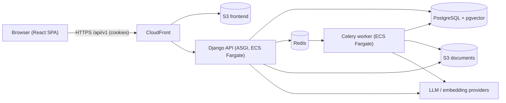
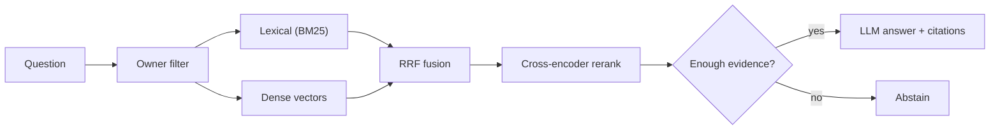

# NOVA AI

**A GPT-style knowledge assistant: upload your documents, ask questions, get cited answers grounded in your own content.**

> ⚠️ **Project status: design/documentation phase.** The architecture, APIs, and plans below are specified in [`docs/`](docs/INDEX.md). **No application code, tests, or cloud infrastructure have been implemented yet.** Anything described as a feature is *planned* unless explicitly marked otherwise. Commands in "Local setup" describe the *intended* workflow.

Built to demonstrate professional full-stack Python engineering: Django/DRF, React/TypeScript, PostgreSQL + pgvector, Celery, hybrid retrieval (BM25 + dense + RRF + reranking), Ragas-based evaluation, Docker, GitHub Actions, and AWS (ECS Fargate, RDS, S3, CloudFront).

---

## Problem statement
- Keyword search misses meaning; LLMs hallucinate; many RAG demos skip permissions, evaluation, testing, and operations.
- NOVA AI aims to show a **grounded, permission-aware, measurable, deployable** RAG application.

## Goals
1. Conversational Q&A over a user's own documents with source citations and abstention.
2. Clean, modular architecture (modular monolith + workers) with strong testing.
3. **Measured** retrieval quality: BM25 vs dense vs hybrid (RRF) vs hybrid + rerank — adopted only if the benchmark supports it.
4. Secure, observable, reproducible delivery from local Docker to AWS.

## Core features (planned)
| Feature | Phase |
|---|---|
| Registration/login (session + CSRF) | MVP |
| Streaming chat UI with Markdown and citations | MVP |
| Document upload (PDF, DOCX, TXT, MD) and background ingestion | MVP |
| Grounded answers, abstention, feedback | MVP |
| BM25/lexical + dense hybrid retrieval, RRF, reranking, query rewriting | Advanced |
| Ragas evaluation, benchmarks, CI regression gates | Advanced |
| LangGraph workflow | Only if justified by evaluation |
| AWS staging/production, monitoring | Advanced |

## Technology stack
**Frontend:** React, TypeScript, Vite, Tailwind CSS, shadcn/ui, React Router, TanStack Query, Markdown rendering, SSE streaming.
**Backend:** Python, Django, Django REST Framework, PostgreSQL, Celery, Redis, pytest.
**AI/RAG:** LLM and embedding provider abstractions, pgvector, PostgreSQL FTS/BM25, RRF, cross-encoder reranking, LangChain (optional utilities), LangGraph (gated), Ragas.
**DevOps/Cloud:** Git/GitHub, Docker Compose, GitHub Actions (OIDC), AWS S3, RDS, ECS Fargate, ECR, IAM, Secrets Manager, CloudWatch, CloudFront.

## Architecture overview


Details: [System architecture](docs/SYSTEM_ARCHITECTURE.md).

## High-level RAG workflow


Details: [RAG pipeline](docs/RAG_PIPELINE.md) · [Evaluation](docs/RAG_EVALUATION.md).

## Repository structure

*Proposed; changes from the original brief are marked ➕.*

```
nova-ai-platform/
├── .github/workflows/        # ci, deploy-staging, deploy-production, eval-full, security
├── backend/
│   ├── config/               # settings (base/dev/test/staging/prod), ASGI/WSGI, celery app
│   ├── apps/
│   │   ├── accounts/         # custom user, auth endpoints
│   │   ├── conversations/    # conversations, messages, message sources, chat streaming
│   │   ├── documents/        # documents, chunks, ingestion tasks
│   │   ├── feedback/
│   │   ├── audit/            # ➕ AuditEvent (security trail)
│   │   ├── evaluations/      # ➕ EvaluationRun (Phase 14)
│   │   └── common/           # base models, permissions, pagination, errors, middleware
│   ├── ai/
│   │   ├── ingestion/  embeddings/  retrieval/  generation/  workflows/  evaluation/
│   ├── tests/
│   ├── requirements/         # ➕ base / dev split (or lockfile)
│   └── Dockerfile
├── frontend/
│   ├── src/ (components, features, hooks, lib, pages, routes, services)
│   └── Dockerfile
├── evaluation/               # corpora (➕), datasets, benchmarks, ragas
├── infra/
│   ├── aws/                  # IaC (tool to be decided)
│   └── docker-compose.yml
├── docs/
├── .env.example  .gitignore  README.md  LICENSE
```
Rationale for changes: [System architecture §5](docs/SYSTEM_ARCHITECTURE.md).

## Local setup *(intended workflow — not yet runnable)*
**Prerequisites:** Docker + Docker Compose, Git, Python (version to be pinned), Node.js LTS (pinned), `make` (optional).

**Environment:** copy `.env.example` → `.env`; keep `PROVIDER_MODE=fake` to run without API keys. Variables documented in [Environment configuration](docs/ENVIRONMENT_CONFIGURATION.md). Never commit `.env`.

**Start (planned):**
```bash
cp .env.example .env
docker compose -f infra/docker-compose.yml up --build   # db, redis, minio, backend, worker, frontend
# backend: http://localhost:8000   frontend: http://localhost:5173
```
**Run without Docker (planned):** start `db`, `redis`, `minio` via Compose; then `python manage.py migrate && python manage.py runserver`, `celery -A config worker -l info`, and `npm run dev` in `frontend/`.

## Testing *(planned)*
```bash
cd backend && pytest                 # unit, API, DB integration (PostgreSQL + pgvector required)
cd frontend && npm test              # Vitest + Testing Library
npx playwright test                  # end-to-end with fake providers
python -m ai.evaluation.run --config evaluation/benchmarks/configs/c3.yaml   # evaluation (planned CLI)
```
Strategy: [Testing strategy](docs/TESTING_STRATEGY.md).

## Docker
Single backend image reused for API, worker, and beat; frontend built to static assets for S3/CloudFront. See [DevOps & CI/CD](docs/DEVOPS_AND_CICD.md).

## AWS deployment overview
CloudFront + S3 (SPA) → ALB → ECS Fargate (`nova-api`, `nova-worker`, `nova-beat`) → RDS PostgreSQL (pgvector) / ElastiCache / S3 documents; ECR, Secrets Manager, CloudWatch; GitHub Actions deploys via OIDC with staging → manual approval → production. Full plan: [AWS deployment](docs/AWS_DEPLOYMENT.md).

## Screenshots
*Placeholders — no UI exists yet.*
- `docs/images/chat.png` — streaming chat with citations *(TBD)*
- `docs/images/documents.png` — upload and ingestion status *(TBD)*
- `docs/images/evaluation-report.png` — benchmark report *(TBD)*

## Roadmap
18 dependency-ordered phases from repository setup to production release: [Implementation roadmap](docs/IMPLEMENTATION_ROADMAP.md). MVP = Phases 1–9 (+ hardening/staging).

## Known limitations *(by design, initially)*
Single-owner data (no sharing), text-extractable documents only (no OCR), English-first tuning, FTS ≠ true BM25 until the benchmark decides, no resumable streams, third-party provider data handling must be reviewed, **no performance or quality numbers exist yet**.

## Security notes
Session cookies + CSRF, Argon2id, owner-scoped queries, authorization applied before retrieval and again before prompting, uploaded/retrieved text treated as untrusted (prompt-injection mitigations), least-privilege IAM, no secrets in the repo. See [Security](docs/SECURITY.md). Report vulnerabilities privately (contact placeholder: `security@example.com`).

## Documentation
Start at the [documentation index](docs/INDEX.md).

## Contributing
1. Open an issue or discuss the change; architectural changes need an ADR ([Decisions](docs/DECISIONS_AND_TRADEOFFS.md)).
2. Branch from `main` (`feat/…`, `fix/…`), keep PRs small, add tests and docs.
3. All CI checks must pass; use Conventional Commits.
4. Never commit secrets or real user data.

## License
*Placeholder — to be selected (e.g., MIT or Apache-2.0).* See `LICENSE`.
