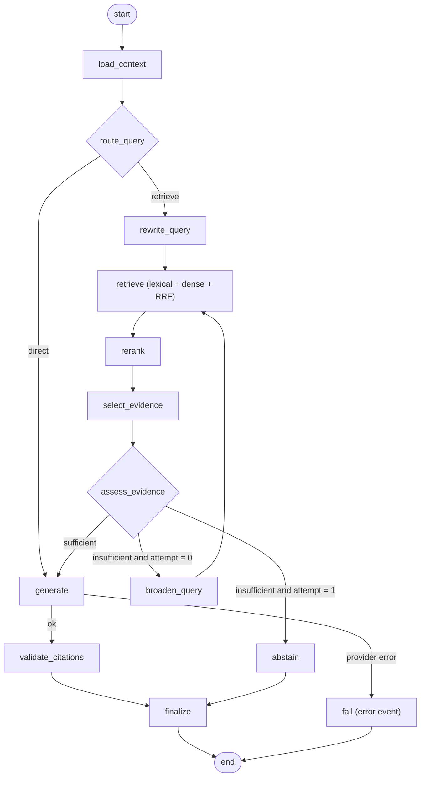

# NOVA AI — AI Workflow Design (LangChain & LangGraph)

Status: **design; LangChain/LangGraph usage is optional and gated by evidence.** Library capabilities, APIs, and streaming behavior change between versions — **[Assumption: verify against the pinned versions before implementation]**. Related: [RAG_PIPELINE](RAG_PIPELINE.md), [DATA_FLOW](DATA_FLOW.md), [DECISIONS_AND_TRADEOFFS](DECISIONS_AND_TRADEOFFS.md) (ADR-004).

## 1. Principles

1. The **baseline pipeline is plain Python** service functions behind interfaces (`Retriever`, `Reranker`, `LLMProvider`, `EmbeddingProvider`). It must be fully functional, tested, and benchmarked **before** any framework orchestration is added.
2. A framework is adopted for a component only if it removes code or adds a capability that is *measured* to help.
3. Django remains the system of record. No framework-owned persistence (no LangGraph checkpointer database) in the MVP.
4. No autonomous tool use. The workflow has no tools with side effects (cannot browse, write, or call APIs) — see [SECURITY](SECURITY.md).

## 2. Workflow categories

| Category | Description | NOVA AI use | Tooling |
|---|---|---|---|
| Simple retrieval chain | question → retrieve → prompt → generate | **MVP baseline (Phase 9–11)** | Plain Python (LangChain optional for utilities) |
| Multi-step conversational | rewrite follow-up → retrieve → answer | Follow-up question handling (Phase 12) | Plain Python function first |
| Stateful workflow | shared state across steps with inspection/trace | Phase 13 candidate | LangGraph |
| Conditional routing | skip retrieval for chit-chat; abstain; broaden search | Phase 13 candidate | LangGraph |
| Query rewriting | resolve pronouns/ellipsis using history | Phase 12 | LLM call (plain or graph node) |
| Retry/fallback | broaden retrieval once, degrade gracefully | Phase 13 candidate | Graph edges or plain `try/except` |

## 3. Where LangChain is useful (and where not)

**Useful (optional, thin usage):**
- Text splitters (`RecursiveCharacterTextSplitter`-style utilities) and some document loaders — saves writing splitting logic. Wrap behind our `Chunker` interface so we can swap it.
- Provider integrations for embeddings/chat models, if they simplify streaming and token accounting. Wrap behind `LLMProvider`/`EmbeddingProvider`.
- Output parsers/prompt templates only if they reduce boilerplate; prompts remain versioned in our repo.

**Not recommended:**
- Using LangChain "chains/agents" as the core orchestration, vector-store abstractions over pgvector (we need custom SQL with permission filters and two retrievers), or memory classes (conversation history comes from our DB).
- Letting framework abstractions hide the permission filter, token budget, or citation logic — these are security-critical and must be explicit, unit-tested code.

## 4. Where LangGraph adds real value

LangGraph earns its place only when there is **conditional control flow with state** that is awkward in straight-line code:
- Branch: *does this message need retrieval at all?* (greeting, thanks, meta-questions)
- Branch: *is the retrieved evidence sufficient?* → generate / retry broader / abstain
- Bounded loop: **at most one** retry with a rewritten or broadened query
- Uniform tracing of per-node inputs/outputs for debugging and evaluation

If evaluation shows these branches do not improve results, **keep the plain-Python pipeline** and record that decision.

## 5. Proposed workflow state

```python
class ChatTurnState(TypedDict):
    # inputs (immutable after start)
    user_id: str
    conversation_id: str
    question: str
    document_ids: list[str] | None
    config: RetrievalConfig            # versioned config snapshot
    # working state
    history: list[Message]             # trimmed, this conversation only
    route: Literal["retrieve", "direct", "abstain"]
    search_query: str
    attempt: int                       # 0 or 1 (max one retry)
    lexical_hits: list[Hit]
    dense_hits: list[Hit]
    fused: list[Hit]
    reranked: list[Hit]
    evidence: list[Evidence]           # authorized, budgeted, numbered
    sufficient: bool
    answer: str
    citations: list[Citation]
    # diagnostics
    degraded: bool
    timings_ms: dict[str, int]
    usage: Usage
    error: ErrorInfo | None
```
State contains **ids and bounded text** — never credentials. The state object is created per request and discarded; persistence happens through Django services at the end.

## 6. Nodes and transitions

| Node | Responsibility | On failure |
|---|---|---|
| `load_context` | Validate ownership, load trimmed history | Abort with error (no LLM call) |
| `route_query` | Decide `retrieve` vs `direct` (rules first; small LLM classifier only if justified) | Default to `retrieve` |
| `rewrite_query` | Standalone search query from question + history (skipped when no history) | Fall back to raw question |
| `retrieve` | Lexical + dense in parallel → RRF | Degrade to the surviving retriever; both fail → `abstain` route |
| `rerank` | Cross-encoder over top candidates | Skip, `degraded=true` |
| `select_evidence` | Authorization re-check, de-dup, token budget, numbering | Empty → `sufficient=false` |
| `assess_evidence` | Threshold gate on scores/count | — |
| `broaden_query` | Only when `attempt == 0` and insufficient: enlarge K, relax filters *within* authorization, or use rewritten query | Go to `abstain` |
| `generate` | Stream answer from LLM | Retry once pre-first-token; else `fail` |
| `validate_citations` | Remove invalid markers; build `MessageSource` data | Never fails the turn; flags |
| `abstain` | Fixed abstention response (no LLM) | — |
| `finalize` | Return result to the Django service for persistence | — |



**Error paths:** every node catches provider/DB exceptions and writes `error`/`degraded` into state; the graph has a single terminal `fail` path. Total graph time is bounded by a per-turn deadline (e.g. node-level timeouts); the loop is bounded by `attempt <= 1` so it cannot run away.

## 7. Streaming and persistence considerations
- Tokens are forwarded from the `generate` node to the SSE response (graph streaming mode vs. a callback/async generator — **[verify the current streaming API and that it works inside an async Django view]**).
- Cancellation: client disconnect cancels the running task; the node's `finally` closes the provider stream.
- Persisting: the Django service writes Message/MessageSource after `finalize`; periodic partial flush during `generate` as in [DATA_FLOW](DATA_FLOW.md) Flow 4.

## 8. Decision gate for adopting LangGraph (Phase 13)
Adopt only if all hold:
1. Baseline pipeline (C3/C4) is stable and benchmarked.
2. A graph variant is run through the same benchmark and shows a measurable gain on at least one target (e.g. follow-up questions Recall@k, abstention accuracy) without unacceptable latency or cost regression.
3. The team can test nodes in isolation and trace failures.
Otherwise retain the plain pipeline; the graph design in this document remains a documented alternative.

## 9. What is explicitly excluded
Multi-agent systems, autonomous tool use, web browsing, code execution, long-term memory stores, self-modifying prompts, and LangGraph checkpoint persistence. Each would need its own security review and ADR.
