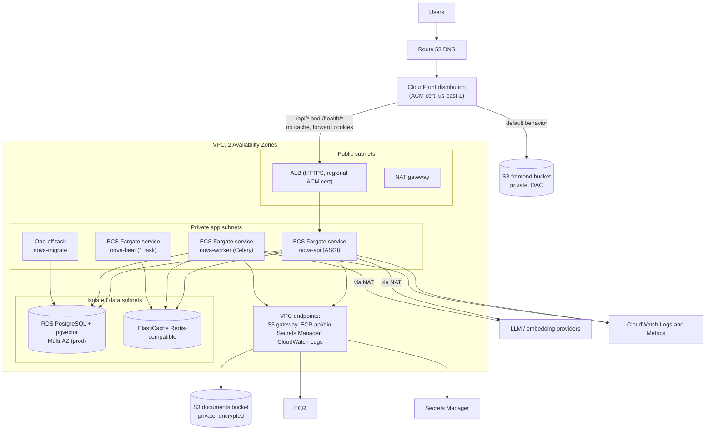

# NOVA AI — AWS Deployment Architecture

Status: **proposed; nothing is provisioned.** Service features, quotas, defaults, and pricing change — items marked **[verify]** must be checked against current AWS documentation. No prices are stated. Infrastructure-as-code tool is an open decision (recommendation: Terraform; alternatives AWS CDK/CloudFormation) — see [DECISIONS_AND_TRADEOFFS](DECISIONS_AND_TRADEOFFS.md). Related: [SYSTEM_ARCHITECTURE](SYSTEM_ARCHITECTURE.md) §9, [DEVOPS_AND_CICD](DEVOPS_AND_CICD.md), [SECURITY](SECURITY.md).

## 1. Topology

## 2. Request, storage, worker, and monitoring paths

- **Request path:** Browser → Route 53 → CloudFront. Static paths served from the S3 frontend bucket (SPA fallback to `index.html` for client routes). `/api/*` forwarded to the ALB with caching disabled, cookies/`X-CSRFToken`/`Authorization-less` headers forwarded, `Host` handled consistently. ALB → ECS API tasks. The API → RDS/Redis/S3/providers. SSE responses: compression off, long enough origin response timeout, heartbeat every ~15 s **[verify CloudFront origin response timeout limits/quotas and streaming behavior; ALB idle timeout is configurable]**.
- **Origin protection:** ALB security group allows inbound 443 only from the **CloudFront managed prefix list** and/or requires a secret custom header injected by CloudFront (stored in Secrets Manager), rejecting direct access **[verify]**.
- **Document storage path:** Browser → API (multipart) → S3 documents bucket via VPC gateway endpoint (task role: write to `documents/*`). Reads happen only in workers. No public object URLs. [Future]: presigned download URLs; presigned direct uploads would change the validation design.
- **Worker path:** API enqueues to Redis → worker (private subnet) consumes → reads S3 → calls embedding provider through NAT → writes PostgreSQL.
- **Monitoring path:** containers log JSON to stdout → `awslogs` driver → CloudWatch Logs; metrics via CloudWatch (ECS/ALB/RDS/ElastiCache built-ins + custom metrics via EMF log lines); alarms → SNS → email/chat ([OBSERVABILITY_AND_RELIABILITY](OBSERVABILITY_AND_RELIABILITY.md)).

## 3. Components and configuration notes

| Component | Design |
|---|---|
| **CloudFront + S3 (frontend)** | Private bucket with Origin Access Control; versioned asset prefix; long cache for hashed assets, short/no cache for `index.html`; security-response-headers policy (CSP etc.); custom error response → `/index.html` for SPA routes (must not mask API 404s — behaviors are path-scoped) |
| **ALB** | HTTPS listener (regional ACM cert), HTTP→HTTPS redirect, target group health check on `/health/ready` or `/health/live`; idle timeout raised for streaming **[verify]**; access logs to S3 (optional) |
| **ECS Fargate – API** | Task: 1 container (ASGI server), CPU/memory sized from load tests (**not guessed here**); desired count ≥ 2 across AZs in production; autoscaling on CPU and/or request count; circuit-breaker rollback; non-root, read-only root FS where possible |
| **ECS Fargate – worker** | Same image, Celery command; concurrency tuned to provider rate limits; scale on queue length (custom metric) or CPU; `stopTimeout` ≥ typical task duration or tasks are idempotent and requeued |
| **ECS – beat** | Exactly **one** task (avoid duplicate scheduling); alternative: EventBridge Scheduler launching one-off tasks |
| **ECS – migrate** | One-off task definition run by the pipeline before service updates |
| **RDS PostgreSQL** | Engine/version chosen so the **pgvector** extension is available at the needed version (HNSW, iterative scan if wanted) **[verify supported versions per region]**; Multi-AZ in production, single-AZ in staging; encrypted (KMS); automated backups + PITR; parameter group tuned after profiling (`shared_buffers`, `maintenance_work_mem` for index builds); `rds.force_ssl`; deletion protection; Performance Insights |
| **ElastiCache (Redis-compatible)** | Used as Celery broker + throttle/cache. Cluster mode must be compatible with Celery (generally **cluster-mode disabled**) **[verify]**; in-transit encryption + AUTH; **durability not assumed** — DB is source of truth, reconciler recovers lost tasks. Alternative worth considering: Amazon SQS as broker (managed durability; different Celery transport semantics) — see [ADR-007](DECISIONS_AND_TRADEOFFS.md) |
| **S3 documents** | Block Public Access, SSE (S3-managed or KMS), TLS-only bucket policy, lifecycle rule for abandoned multipart uploads, optional versioning with short noncurrent expiry, access logging/CloudTrail data events optional |
| **ECR** | Immutable tags, scan on push, lifecycle policy |
| **Secrets Manager** | DB credentials, Django secret key, provider API keys, CloudFront origin header; injected via ECS task-definition `secrets`; rotation configured for DB credentials |
| **IAM** | See §5 |
| **CloudWatch** | Log groups per service with retention; dashboards; alarms |
| **WAF (optional)** | AWS-managed rule groups + rate-based rule on CloudFront for `/api/v1/auth/*` |

## 4. Networking and security groups

| SG | Inbound | Outbound |
|---|---|---|
| `sg-alb` | 443 from CloudFront prefix list (and 80 redirect if needed) | to `sg-api` app port |
| `sg-api` | app port from `sg-alb` | 5432→`sg-db`, 6379→`sg-redis`, 443 to VPC endpoints and (via NAT) internet |
| `sg-worker` | none | same as API |
| `sg-db` | 5432 from `sg-api`, `sg-worker`, `sg-migrate` | none |
| `sg-redis` | 6379 from `sg-api`, `sg-worker`, `sg-beat` | none |
| `sg-vpce` | 443 from app SGs | — |

Egress to LLM/embedding providers requires internet access → **NAT gateway** (a significant fixed cost driver; one per AZ for HA or one shared in staging). Consider restricting egress with proxy/allow-listing [Future]. DB/Redis have no route to the internet.

## 5. IAM roles

| Role | Used by | Key permissions (least privilege) |
|---|---|---|
| `nova-ecs-execution` | ECS agent | pull from the specific ECR repos, write CloudWatch logs, `secretsmanager:GetSecretValue` on the specific secret ARNs |
| `nova-api-task` | API container | `s3:PutObject`, `s3:GetObject`, `s3:DeleteObject` on `docs-bucket/documents/*`; `kms:Decrypt/GenerateDataKey` if CMK; optionally `cloudwatch:PutMetricData` |
| `nova-worker-task` | worker/beat/migrate | `s3:GetObject`, `s3:DeleteObject` on `documents/*`; no `PutObject` unless needed |
| `gha-<env>-deploy` | GitHub Actions (OIDC) | See [DEVOPS_AND_CICD](DEVOPS_AND_CICD.md) §4 |
Policies are scoped by ARN and prefix; no `*:*`.

## 6. Environment separation
Separate AWS **accounts** per environment is the strongest option (recommended when feasible); minimum viable alternative: separate VPCs/stacks, buckets, databases, secrets, and IAM roles with distinct naming and tags in one account. Staging and production share **no** database, bucket, secret, or Redis. Staging uses lower-capacity settings (single-AZ DB, one NAT) and synthetic data.

## 7. Domain and HTTPS
Route 53 hosted zone; `app.<domain>` alias to CloudFront; ACM certificate for CloudFront in **us-east-1** and a regional ACM certificate for the ALB; TLS policy ≥ TLS 1.2; HSTS enabled after verification. Origin-to-viewer redirect HTTP→HTTPS.

## 8. Database migrations, backups, and recovery
- Migrations via the one-off `nova-migrate` task ([DEVOPS_AND_CICD](DEVOPS_AND_CICD.md) §7).
- RDS automated backups + PITR (retention set per environment), manual snapshot before risky migrations, **scheduled restore drill** into a scratch instance; verify pgvector indexes after restore.
- S3 documents: versioning optional; replication [Future]. Redis is rebuildable (cache/queue only).
- Draft recovery targets in [OBSERVABILITY_AND_RELIABILITY](OBSERVABILITY_AND_RELIABILITY.md) §9.

## 9. Deployment health checks and rollback
ECS circuit breaker + ALB health checks; post-deploy smoke tests; rollback by redeploying the previous task definition revision/digest; frontend rollback by restoring the previous asset set; DB changes rolled **forward** (expand/contract). Details: [DEVOPS_AND_CICD](DEVOPS_AND_CICD.md) §8.

## 10. Observability
CloudWatch log groups (`/nova/<env>/api`, `/worker`, `/beat`) with retention; Container Insights **[evaluate cost/benefit]**; alarms on ALB 5xx rate, target response time, unhealthy hosts, ECS task restarts, RDS CPU/connections/free storage/replica lag, Redis memory/evictions, queue depth, ingestion failure rate, LLM error rate. Optional tracing (OpenTelemetry/X-Ray) [Future].

## 11. Staged deployment plan

| Stage | Environment | Goal | Exit criteria |
|---|---|---|---|
| 0 | **Local** (docker-compose: Postgres+pgvector, Redis, MinIO, API, worker, frontend) | Develop and test with fake or dev-key providers | Tests green; E2E smoke passes locally |
| 1 | **Foundations in AWS** (IaC): VPC, subnets, endpoints, ECR, S3, Secrets, IAM, OIDC | Reproducible infra; pipeline can push images | `terraform plan/apply` clean; OIDC role works |
| 2 | **Staging data tier**: RDS (pgvector verified), ElastiCache | Validate extension, migrations, connectivity from a task | Migration task succeeds; `vector` extension verified |
| 3 | **Staging services**: API, worker, beat, ALB, CloudFront, frontend | End-to-end in AWS with real providers at low spend caps | Smoke + Playwright pass; streaming verified through CloudFront/ALB; load test baseline recorded |
| 4 | **Staging hardening**: alarms, dashboards, WAF (optional), backup restore drill, security scan | Operational readiness | Checklist signed off; restore drill done |
| 5 | **Production** (separate account/stack, Multi-AZ, ≥2 API tasks) | Controlled launch behind approval | Approved release tag; health + smoke pass; rollback rehearsed |
| 6 | **Post-launch**: cost review, scaling tuning, SLO review | Optimize | Budget alarms active; review notes recorded |

## 12. Cost drivers and controls (no prices stated)

| Driver | Control |
|---|---|
| **LLM and embedding API usage** (typically dominant) | Token budgets, `MAX_OUTPUT_TOKENS`, throttles/quotas, abstention gate skipping generation, embedding batching and caching, provider spend limits, per-environment keys, cost metrics per request |
| NAT gateway (hourly + data processing) | VPC endpoints for S3/ECR/Secrets/Logs; single NAT in staging; review traffic |
| RDS (instance, Multi-AZ, storage, backups, IOPS) | Right-size from metrics; non-prod smaller/stoppable; retention tuning |
| Fargate tasks (vCPU/memory × time) | Right-size, autoscale, schedule staging down off-hours, reranker memory footprint |
| ElastiCache node | Smallest viable node; consider SQS alternative |
| ALB / CloudFront / data transfer | Cache static assets; compress non-SSE responses |
| CloudWatch Logs/metrics | Log levels, retention, avoid logging bodies, metric cardinality control |
| ECR/S3 storage | Lifecycle policies |
Set AWS Budgets + anomaly detection alerts; tag all resources (`project`, `env`).

## 13. Open items to verify before provisioning
pgvector version/features on chosen RDS engine; CloudFront streaming/timeout behavior and quotas; ALB idle timeout settings; Celery–ElastiCache compatibility mode; reranker memory needs vs Fargate task size; region availability of chosen services; data-residency requirements.
