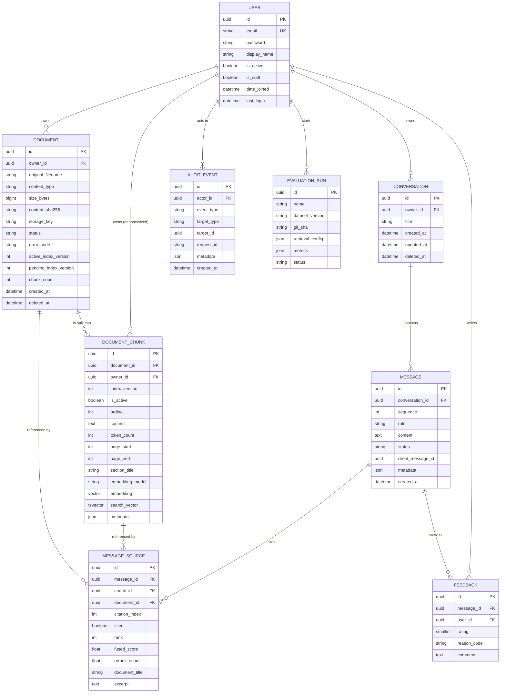

# NOVA AI — Database Design

Status: **proposed schema; no migrations exist.** Engine: PostgreSQL with the `pgvector` extension **[Assumption: confirm the chosen RDS engine version offers a pgvector version supporting HNSW and the needed features]**. Related: [DATA_FLOW](DATA_FLOW.md), [API_SPECIFICATION](API_SPECIFICATION.md), [RAG_PIPELINE](RAG_PIPELINE.md).

Conventions: UUID primary keys (`uuid4`, no information leak, safe in URLs); timestamps are `timestamptz` in UTC (`created_at` auto-set, `updated_at` auto-updated); `snake_case` columns; text enums stored as `varchar` with CHECK constraints (Django `TextChoices`) — easier to migrate than native enums.

## 1. MVP scope of tables

| Model | MVP? | Reason |
|---|---|---|
| User | **Essential** | Identity, ownership |
| Conversation | **Essential** | Chat grouping |
| Message | **Essential** | Chat history |
| Document | **Essential** | Metadata + ingestion state |
| DocumentChunk | **Essential** | Retrieval unit (text, FTS, vector) |
| MessageSource | **Essential** | Citations |
| Feedback | Early (Phase 9+) | Cheap, valuable for review |
| AuditEvent | Phase 15 (hardening); minimal logging earlier | Security trail |
| EvaluationRun | Phase 14 | Benchmarking records (results can live in files before this) |

No `Organization`, `DocumentVersion`, `Tag`, or `ChunkEmbedding` tables are introduced (see §12).

## 2. ER diagram

## 3. Model specifications

### 3.1 User (`accounts.User`)
- **Purpose:** identity and ownership root. **Custom user model from day one** (`AUTH_USER_MODEL`), because changing it after migrations exist is painful.
- **Base:** `AbstractBaseUser` + `PermissionsMixin`; `USERNAME_FIELD = "email"`.
- **Fields:** `id uuid PK`; `email varchar(254)` unique **case-insensitively** (functional unique index on `lower(email)`; normalize on save); `password varchar(128+)` (Argon2id encoded hash); `display_name varchar(80)`; `is_active bool default true`; `is_staff bool`; `is_superuser bool`; `date_joined`, `last_login`, `updated_at`.
- **Constraints/indexes:** unique `lower(email)`.
- **Relationships:** owns conversations, documents, chunks (denormalized), feedback.
- **Tenant scope:** the user *is* the tenant in the MVP.
- **Deletion:** account deletion is a **hard delete cascade** (conversations, messages, documents, chunks, feedback) plus a purge task for S3 objects; `AuditEvent.actor` becomes `NULL` (SET_NULL) and events keep only the user id snapshot in metadata hash-free form (see §9).
- **Validation:** password validators; email normalized lowercase; never expose `password`, `is_staff`.

### 3.2 Conversation (`conversations.Conversation`)
- **Purpose:** ordered chat thread.
- **Fields:** `id`, `owner FK(User, CASCADE)`, `title varchar(120)` (default derived from first question, user-editable), `created_at`, `updated_at` (bumped when a message is added), `deleted_at null` (soft delete → purge job hard-deletes after grace period; MVP may hard-delete immediately).
- **Indexes:** `(owner_id, updated_at DESC) WHERE deleted_at IS NULL` for the sidebar list.
- **Ownership:** owner only; non-owners get 404.
- **Validation:** title non-empty after strip, ≤120 chars.

### 3.3 Message (`conversations.Message`)
- **Purpose:** one turn element, user or assistant.
- **Fields:** `id`; `conversation FK(CASCADE)`; `sequence int` (monotonic per conversation); `role` ∈ {`user`,`assistant`}; `content text`; `status` ∈ {`streaming`,`complete`,`cancelled`,`failed`} (user messages are always `complete`); `client_message_id uuid null` (idempotency key supplied by the client for user messages); `metadata jsonb` (see below); `created_at`.
- **Constraints:** `UNIQUE(conversation_id, sequence)`; `UNIQUE(conversation_id, client_message_id) WHERE client_message_id IS NOT NULL`; CHECK on role/status.
- **Indexes:** `(conversation_id, sequence)` covers history loading.
- **`metadata` JSON (justified):** variable, non-queried diagnostic data: `retrieval_config` snapshot, `search_query`, `timings_ms{retrieval,rerank,llm_first_token,total}`, `usage{prompt_tokens,completion_tokens}`, `model`, `degraded`, `abstained`, `error_code`. If a field becomes a frequent filter (e.g. `abstained` for dashboards), promote it to a column.
- **Sequence allocation:** inside a transaction `SELECT … FOR UPDATE` on the conversation row (or an `UPDATE conversation SET last_sequence = last_sequence + 1 RETURNING`) — avoids duplicates under concurrent sends.
- **Deletion:** cascades with the conversation; cascades to `MessageSource` and `Feedback`.
- **Validation:** `content` ≤ `MAX_MESSAGE_CHARS` for user messages.

### 3.4 Document (`documents.Document`)
- **Purpose:** metadata and ingestion state for an uploaded file. The file itself lives in S3.
- **Fields:** `id`; `owner FK(CASCADE)`; `original_filename varchar(255)` (display only); `content_type varchar(100)` (server-detected); `size_bytes bigint`; `content_sha256 char(64)`; `storage_key varchar(512)` (derived, never user-provided); `status` ∈ {`uploaded`,`queued`,`processing`,`ready`,`failed`,`deleting`}; `error_code varchar(50) null`; `error_detail varchar(255) null` (user-safe text); `ingestion_attempts int`; `active_index_version int null`; `pending_index_version int null`; `chunk_count int default 0`; `page_count int null`; `embedding_model varchar(100) null` (of the active version); `created_at`, `updated_at`, `ready_at null`, `deleted_at null`.
- **Constraints:** `UNIQUE(owner_id, content_sha256) WHERE deleted_at IS NULL` (duplicate handling); CHECK status; `size_bytes > 0`.
- **Indexes:** `(owner_id, created_at DESC)`; `(status, updated_at)` for the reconciler.
- **Versioning:** each ingestion produces an `index_version`; a content change is a **new upload** (new hash → new Document). Document-level revision history is [Future] (see §12).
- **Deletion:** see [DATA_FLOW](DATA_FLOW.md) §2.5 — chunks deactivated synchronously, purge asynchronously, row hard-deleted at the end; `MessageSource.document` is `SET_NULL`.

### 3.5 DocumentChunk (`documents.DocumentChunk`)
- **Purpose:** the retrieval unit. Holds text, lexical index data, and the embedding in one row so one query can filter, rank, and join cheaply.
- **Fields:** `id uuid`; `document FK(CASCADE)`; `owner FK(CASCADE)` (**denormalized** so retrieval filters without a join; must always equal `document.owner_id` — enforced by a DB trigger or a service-layer invariant plus a test); `index_version int`; `is_active bool default false`; `ordinal int`; `content text`; `content_sha256 char(64)`; `token_count int`; `page_start int null`; `page_end int null`; `section_title varchar(255) null`; `embedding_model varchar(100)`; `embedding vector(N)`; `search_vector tsvector` (**generated column**: `to_tsvector(<config>, content)`; the text-search configuration is a design choice — e.g. `simple` vs. language-specific — see §6); `metadata jsonb`; `created_at`.
- **`N` = embedding dimension.** Fixed in the migration. Changing model/dimension requires a new column or table plus re-index — hence `embedding_model` is stored per chunk **[Assumption: verify the dimension limit for HNSW on the installed pgvector version]**.
- **Constraints:** `UNIQUE(document_id, index_version, ordinal)`.
- **Indexes:** see §5/§6.
- **Deletion:** cascade from Document; purge task deletes in batches.
- **Validation:** `content` non-empty; `owner_id == document.owner_id`.

### 3.6 MessageSource (`conversations.MessageSource`)
- **Purpose:** records which chunks were provided as evidence for an assistant message and which were actually cited → powers the citation UI, auditability, and citation-correctness evaluation.
- **Fields:** `id`; `message FK(CASCADE)` (assistant message); `chunk FK(SET_NULL, null)`; `document FK(SET_NULL, null)`; `citation_index int` (the `[n]` shown to the model and user); `cited bool` (appears in the final answer); `rank int` (final evidence order); `retrieval_score float null` (lexical/dense/fused as available); `fused_score float null`; `rerank_score float null`; **snapshots:** `document_title varchar(255)`, `page_start`, `page_end`, `excerpt text` (≤ ~500 chars shown to the user).
- **Constraints:** `UNIQUE(message_id, citation_index)`.
- **Indexes:** `(message_id)`; `(chunk_id)`.
- **Why snapshots:** if a document is later re-indexed or deleted, the stored answer's citations remain interpretable. On document **deletion**, `excerpt` and `document_title` are blanked and the UI shows "source deleted".
- **Ownership:** inherited via message → conversation → owner.

### 3.7 Feedback (`feedback.Feedback`)
- **Fields:** `id`; `message FK(CASCADE)`; `user FK(CASCADE)`; `rating smallint` ∈ {-1, 1}; `reason_code` ∈ {`inaccurate`,`not_grounded`,`wrong_source`,`incomplete`,`other`} (null for positive); `comment text` ≤ 2000 chars; `created_at`, `updated_at`.
- **Constraints:** `UNIQUE(message_id, user_id)`; CHECK rating; message must have `role=assistant`.
- **Deletion:** cascades with message/user. Ownership: user must own the message's conversation.

### 3.8 EvaluationRun (`evaluations.EvaluationRun`) — Phase 14
- **Fields:** `id`; `name`; `dataset_name`; `dataset_version`; `corpus_version`; `git_sha`; `retrieval_config jsonb`; `generation_config jsonb`; `status` ∈ {`running`,`completed`,`failed`}; `metrics jsonb` (aggregates + per-category); `artifact_key` (S3 key of detailed JSON/CSV report); `started_at`, `finished_at`; `created_by FK(User, SET_NULL)`.
- **Indexes:** `(dataset_version, started_at DESC)`. Not user-visible; admin/CLI only.

### 3.9 AuditEvent (`audit.AuditEvent`) — Phase 15
- **Purpose:** append-only security trail.
- **Fields:** `id`; `actor FK(User, SET_NULL, null)`; `event_type varchar(60)` (e.g. `user.login`, `user.login_failed`, `document.uploaded`, `document.deleted`, `conversation.deleted`, `account.deleted`); `target_type`, `target_id uuid null`; `request_id`; `ip_address inet null` (retention-limited); `user_agent varchar(255)` (truncated); `metadata jsonb` (**never** document text, prompts, or answers); `created_at`.
- **Indexes:** `(actor_id, created_at DESC)`, `(event_type, created_at DESC)`.
- **Immutability:** no update/delete via application code; DB permissions can deny `UPDATE/DELETE` to the app role (recommendation). Retention: configurable (e.g. 1 year; to be decided).

## 4. PostgreSQL transactions

- Wrap multi-row writes in `transaction.atomic()`: message pair creation, final answer + sources, ingestion swap, delete cut-off.
- Enqueue Celery tasks via `transaction.on_commit` so workers never see uncommitted rows.
- Use `select_for_update` on Document for ingestion guards and on Conversation for sequence allocation.
- Default isolation `READ COMMITTED` is sufficient; correctness relies on constraints and row locks, not serializability.
- Long LLM streams must **not** hold a transaction open; commit before streaming, commit again at the end.

## 5. Vector storage and indexes

- Embeddings are stored in `DocumentChunk.embedding`, **not** in a separate table, so filters (`owner_id`, `is_active`) and distance ordering run in one query plan.
- **Distance:** cosine (`vector_cosine_ops`) assuming normalized embeddings; confirm the embedding provider's recommended metric.
- **Index options**

| Index | Pros | Cons |
|---|---|---|
| **No ANN index (exact scan)** after btree filter on `owner_id` | Perfect recall; no build/maintenance; good when each user has few thousand chunks | Cost grows with per-user chunk count |
| **HNSW** | Strong recall/latency trade-off; no training step; can be built on an empty table | Slower builds, more memory; **filtered queries can return fewer than k rows** because filtering happens after the ANN scan — newer pgvector versions provide iterative scans to mitigate **[verify availability on RDS]** |
| **IVFFlat** | Smaller/faster to build | Needs representative data to build lists; recall depends on `probes`; weaker with changing data |

- **Recommendation:** start with exact search constrained by `(owner_id, is_active)`; add a partial HNSW index (`WHERE is_active`) when `EXPLAIN ANALYZE` on realistic data shows a need; always re-measure recall against exact search. Index choice is recorded in [ADR-011](DECISIONS_AND_TRADEOFFS.md).
- Per-user partitioning (list partition by owner) is a [Future] option for large multi-tenant data.

## 6. Full-text / BM25 strategy

PostgreSQL FTS (`tsvector` + GIN, ranked with `ts_rank_cd`) is **not** BM25: it lacks document-length normalization in the BM25 sense and IDF over the corpus. The design therefore defines a **`LexicalRetriever` interface** with two implementations:

1. `PostgresFtsRetriever` — MVP default. GIN index on `search_vector`; query via `websearch_to_tsquery`/`plainto_tsquery`; filter by `owner_id`, `is_active`.
2. `Bm25Retriever` (true BM25 using a library such as `rank_bm25`, or an extension such as ParadeDB `pg_search` **[verify availability on RDS — likely unavailable]**) — computes BM25 over the user's active chunks, with per-user in-memory index cached by retrieval epoch. Suitable for small per-user corpora and for the benchmark.

The benchmark ([RAG_EVALUATION](RAG_EVALUATION.md)) compares both; documents refer to the lexical stage as "BM25/lexical retrieval" and always state which implementation is active. Text-search language configuration (`simple` vs `english` etc.) is an open decision ([DECISIONS_AND_TRADEOFFS](DECISIONS_AND_TRADEOFFS.md)).

Indexes on `DocumentChunk`:
- `GIN (search_vector) WHERE is_active`
- `btree (owner_id, is_active)`
- `btree (document_id, index_version, ordinal)` (unique)
- Optional later: `HNSW (embedding vector_cosine_ops) WHERE is_active`

## 7. JSON fields (where justified)
`Message.metadata`, `DocumentChunk.metadata`, `EvaluationRun.*`, `AuditEvent.metadata` — diagnostic or experiment data that varies by version. Anything used in `WHERE` clauses or joins gets a real column.

## 8. Chunk–document relationship and index versions
`Document 1—N DocumentChunk`. Many versions of chunks may exist briefly for one document (inactive pending + active). Exactly one version is active; retrieval only touches `is_active = true`. Old versions are deleted after the swap commit.

## 9. Retention and deletion

| Data | Retention |
|---|---|
| Documents, chunks | Until user deletes the document or account |
| Conversations/messages | Until user deletes them or the account |
| Feedback | With the message; comments reviewed and purged per policy |
| Audit events | Fixed retention (proposed ≈ 1 year; decide) |
| Logs (CloudWatch) | Short, configurable (e.g. 30–90 days) |
| Backups | Contain deleted data until they expire; document the window to users |

Account deletion: cascade DB rows; purge S3 prefix `documents/{owner_id}/`; write an anonymous audit event.

## 10. Django specifics
- Custom user model created in the **first** migration of the project.
- `pgvector` Python package provides `VectorField` and index classes; the `vector` extension is created by a privileged one-off step on RDS (the application role should not be superuser) **[verify privileges]**.
- `search_vector` as `GeneratedField` (Django 5+) or a raw SQL migration; verify support for generated `tsvector` with the chosen text-search config.
- Use `RunSQL` for partial/functional indexes if the ORM cannot express them.

## 11. Migration strategy
- Backward-compatible **expand → migrate → contract** migrations so old and new application versions can run simultaneously during rolling deploys.
- Migrations run in a **one-off ECS task** before service update ([DEVOPS_AND_CICD](DEVOPS_AND_CICD.md)); CI runs `makemigrations --check` and applies migrations to a fresh pgvector database.
- Large index builds use `CREATE INDEX CONCURRENTLY` (Django: `AddIndexConcurrently`, non-atomic migration).
- Never edit applied migrations; no destructive column drops in the same release that stops using them.

## 12. Deliberately omitted (until needed)
`Organization/Membership` (multi-tenancy), `DocumentVersion`, `Tag/Collection`, `ChunkEmbedding` (multiple embeddings per chunk), `ConversationSummary`, `ApiKey`. Each can be added without breaking the current schema.
