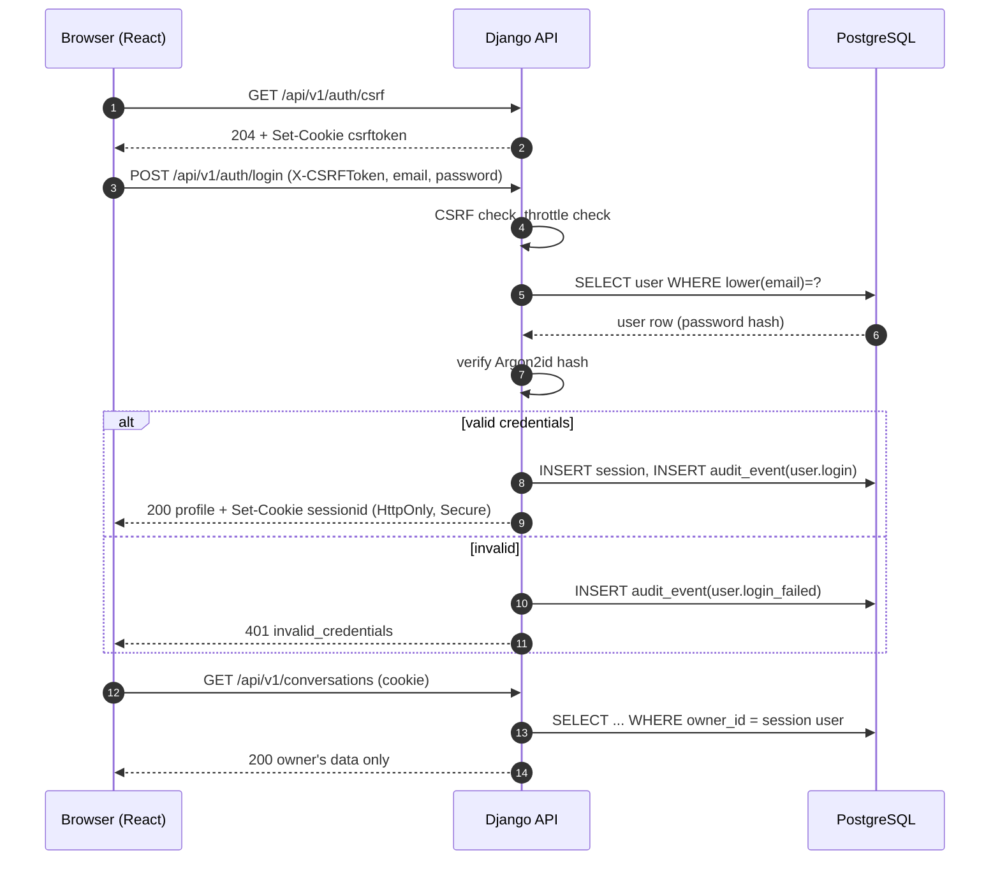
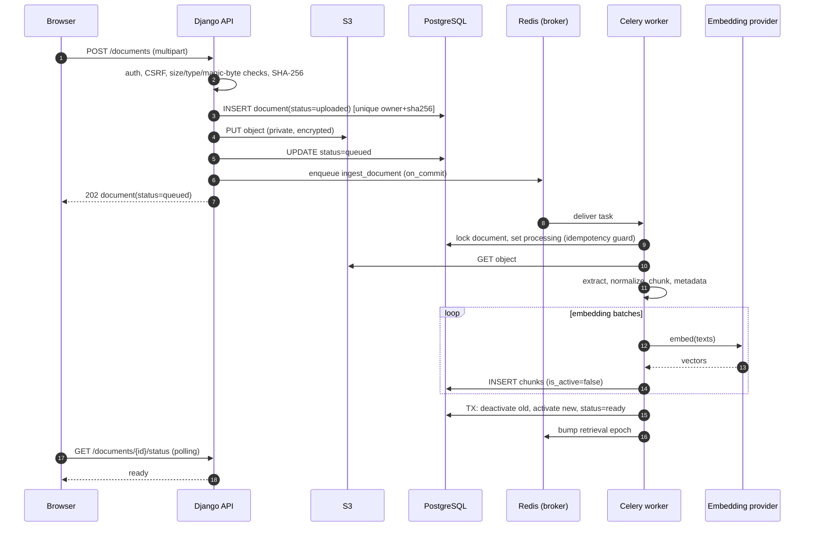
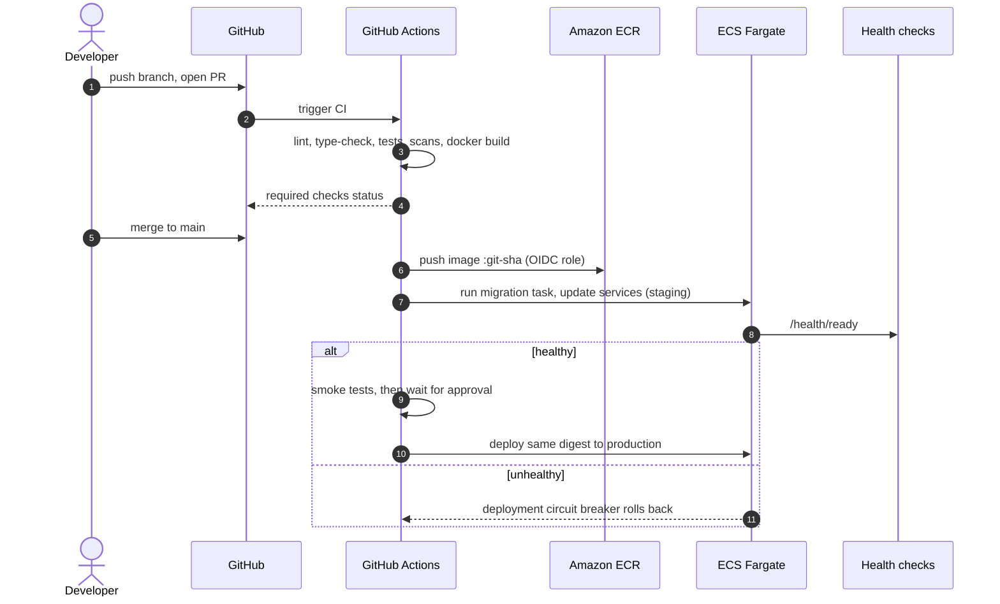
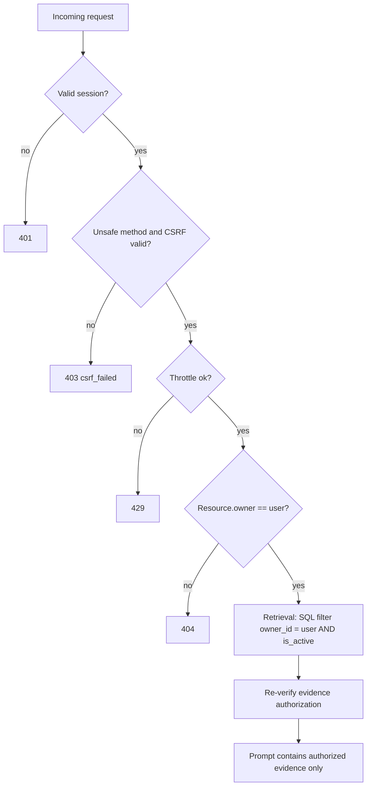

# NOVA AI — Data Flow

Status: **design only, nothing implemented.** Terminology follows [DATABASE_DESIGN](DATABASE_DESIGN.md); endpoints follow [API_SPECIFICATION](API_SPECIFICATION.md); retrieval details are in [RAG_PIPELINE](RAG_PIPELINE.md).

Document status values: `uploaded → queued → processing → ready | failed`, plus `deleting`.
Message status values: `streaming → complete | cancelled | failed`.

---

## Flow 1 — Registration and login

### 1.1 Authentication approach (recommendation)

**Server-side sessions in an `HttpOnly` cookie + Django CSRF protection**, with the SPA and API served from the same origin (CloudFront routes `/api/*` to the API).

| Option | Pros | Cons |
|---|---|---|
| **Session cookie (chosen)** | Token never readable by JS (XSS cannot steal it); instant server-side revocation; built into Django; CSRF well understood | Requires same-site deployment; CSRF handling needed; less convenient for mobile/third-party clients |
| JWT in `localStorage` | Easy cross-origin use | Any XSS exfiltrates the token; revocation is hard — **rejected** |
| JWT access token in memory + refresh cookie | Works cross-origin; mobile-friendly | Two token lifecycles, refresh rotation, revocation lists — more code to get wrong |

Revisit if a native mobile client or third-party API access becomes a requirement ([ADR-006](DECISIONS_AND_TRADEOFFS.md)).

### 1.2 Registration steps

1. SPA calls `GET /api/v1/auth/csrf` once → server sets the `csrftoken` cookie.
2. User submits email, password, display name. SPA sends `POST /api/v1/auth/register` with header `X-CSRFToken`.
3. Django verifies CSRF, applies the **registration throttle** (per IP).
4. Serializer validates: email syntax and length; normalized to lowercase; password through Django validators (minimum length 12 recommended, common-password check, similarity to email, not numeric-only).
5. Uniqueness check against `lower(email)` unique index. The DB constraint is the source of truth (handles races).
6. Password is hashed with **Argon2id** (`argon2-cffi`, first entry in `PASSWORD_HASHERS`; PBKDF2 retained to verify legacy hashes). Plaintext is never logged or stored.
7. User row is created in a transaction; an `AuditEvent(user.registered)` is written in the same transaction.
8. The user is logged in (session created, session key cycled) and `201` is returned with the user profile (no hash, no internal flags).

**Errors:** `400 validation_error` (field-level messages), `409 email_unavailable`, `429 throttled`.
*Known trade-off:* the MVP reveals whether an email exists. Mitigated by throttling; a generic response needs email verification ([Future]).

### 1.3 Login steps

1. `POST /api/v1/auth/login` with CSRF header. Throttled by IP **and** by email.
2. `authenticate()` loads the user by normalized email and verifies the hash. For unknown emails a dummy hash check runs to equalize timing.
3. Inactive users are rejected with the same generic error.
4. On success: `login()` creates a new session (session fixation prevented by key rotation), CSRF token is rotated, `AuditEvent(user.login)` recorded, `last_login` updated.
5. Response `200` with profile. Cookie attributes: `HttpOnly; Secure; SameSite=Lax; Path=/`.
6. Failure → `401 invalid_credentials` (never states which part was wrong). `AuditEvent(user.login_failed)` recorded (no password).

### 1.4 Authorization on every later request

`SessionAuthentication` → `request.user`; permission class `IsAuthenticated`; object access via `get_object_or_404(Model, pk=..., owner=request.user)`. Logout (`POST /auth/logout`) flushes the server-side session.



---

## Flow 2 — Document upload and ingestion

### 2.1 Synchronous phase (API)

1. User picks a file in the React upload UI; client pre-checks extension and size (UX only — **not** a security control).
2. `POST /api/v1/documents` (multipart). Authentication + CSRF + upload throttle.
3. **Validation** (server is authoritative):
   - Size ≤ `MAX_UPLOAD_MB` (proposed default 20 MB); reject `413 file_too_large`. Reject zero bytes.
   - Extension allowlist (MVP: `.pdf`, `.docx`, `.txt`, `.md`) **and** content sniffing (magic bytes) that must agree; reject `415 unsupported_media_type`.
   - Filename sanitized for display; it is **never** used in storage paths.
   - Per-user quota checks (document count, total bytes) → `409 quota_exceeded`.
4. While reading the upload stream, compute **SHA-256**.
5. **Duplicate handling:** unique constraint `(owner_id, content_sha256)` over non-deleted documents. If a `ready`/in-progress duplicate exists → `409 duplicate_document` with `existing_document_id`. If the existing one is `failed`, response suggests `POST /documents/{id}/reindex`.
6. In one transaction: insert `Document(status=uploaded)`; storage key = `documents/{owner_id}/{document_id}/original`.
7. Upload to S3 (server-side encryption on, private bucket). On failure → mark row `failed(error_code=storage_error)` (or delete it) → `503`.
8. Set `status=queued`, then `transaction.on_commit(lambda: ingest_document.delay(document_id, pending_index_version))`.
9. Return `202 Accepted` with the document resource (`status=queued`). The SPA polls `GET /documents/{id}/status` (TanStack Query `refetchInterval` while non-terminal).

**Failure windows:** crash between steps 7 and 8 leaves `uploaded`; Redis outage leaves `queued` without a task. A periodic **reconciler** (Celery beat) re-enqueues documents stuck in `uploaded`/`queued`/`processing` beyond a timeout, and deletes orphan S3 objects.

### 2.2 Asynchronous phase (worker task `ingest_document`)

Task input: `document_id`, `index_version` (integers/UUIDs only; never paths).

1. **Acquire & guard (idempotency):** `SELECT … FOR UPDATE` on the document. If `deleted_at` is set or `pending_index_version != index_version` → exit (stale task). If `status=ready` with this version active → exit (already done). Else set `processing`.
2. **Download** from S3 using the key stored in the row.
3. **Extract text:** PDF (per-page text with page numbers), DOCX (paragraphs/headings/tables), TXT/MD. Encrypted PDFs, corrupt files, or files with no extractable text (scanned images; OCR is [Future]) → **permanent failure**.
4. **Normalize:** Unicode NFC, remove control characters, collapse whitespace, de-hyphenate line-wraps (conservatively), preserve headings and page boundaries.
5. **Chunk:** structure-aware recursive splitting (initial hypothesis: ~512 tokens, ~64 overlap; tuned via benchmark).
6. **Attach metadata:** `ordinal`, `page_start/end`, `section_title`, `token_count`, `content_sha256`, `owner_id`, `document_id`.
7. **Generate embeddings** in batches via `EmbeddingProvider`; record `embedding_model`.
8. **Write chunks** (in batches) with `index_version = N`, `is_active = false`. If a previous attempt left inactive chunks for version N, delete them first (idempotent restart).
9. **Atomic swap (single transaction):** deactivate chunks of the old active version; activate version N chunks; set `active_index_version = N`, `pending_index_version = NULL`, `chunk_count`, `status=ready`, `ready_at`; write `AuditEvent(document.indexed)`.
10. **After commit:** bump the user's retrieval epoch in Redis (invalidates retrieval cache), delete old-version chunks (deferred cleanup task).

### 2.3 Retries and failures

| Error class | Examples | Behavior |
|---|---|---|
| Transient | embedding 429/5xx, network, S3 throttling | `autoretry_for`, exponential backoff + jitter, max ~5 attempts; status stays `processing` |
| Permanent | encrypted/corrupt file, no text, unsupported structure | No retry; `failed` + `error_code` (`encrypted_pdf`, `no_extractable_text`, `corrupt_file`, …) + user-safe message |
| Exhausted retries | provider down | `failed(error_code=provider_unavailable)`; user can press **Retry** (`reindex`) |
| Worker killed | OOM, deploy | `acks_late` + `reject_on_worker_lost`; redelivery safe because of step 1; reconciler as backstop |

Raw document text is **never** written to logs or error messages ([OBSERVABILITY_AND_RELIABILITY](OBSERVABILITY_AND_RELIABILITY.md)).

### 2.4 Re-indexing
`POST /documents/{id}/reindex` sets `pending_index_version = max(known)+1`, status `queued` (while the previously active version **keeps serving**), enqueues the task. Swap in step 2.2.9 means users never see a half-built index. Used for: chunking changes, embedding-model change, failed-document retry.

### 2.5 Deletion
1. `DELETE /documents/{id}` → one transaction: `status=deleting`, `deleted_at=now`, `UPDATE chunks SET is_active=false`, AuditEvent. **From this commit, the document can no longer be retrieved.**
2. After commit: bump retrieval epoch; enqueue `purge_document`.
3. `purge_document` (idempotent): delete S3 object, delete chunk rows, blank the `excerpt` and `document_title` snapshots in `MessageSource` rows referencing it (so removed content does not linger in chat history), then delete the Document row.
4. Return `204`.

### 2.6 Embedding / index consistency rules
- A chunk's `embedding_model` and dimension must match the current query-embedding configuration; the dense retriever filters on it.
- Changing the embedding model = re-index **all** documents to new versions, then flip configuration. Until flipped, queries keep using the old model. (One active model at a time in the MVP.)
- The FTS `tsvector` is a generated column so lexical and dense indexes cannot drift.



---

## Flow 3 — User asks a question

Entry: `POST /api/v1/conversations/{id}/messages` (SSE response, see Flow 4). Step table — *consumes → produces → failure points*:

| # | Step | Consumes | Produces | Failure points / handling |
|---|---|---|---|---|
| 1 | Authenticate + CSRF + throttle | cookie, header | `request.user` | 401/403/429 |
| 2 | Validate request | JSON: `content`, `client_message_id`, optional `document_ids` | validated input | 422 on empty/oversize (`MAX_MESSAGE_CHARS`) |
| 3 | **Conversation ownership** | conversation id, user | Conversation or 404 | Non-owner → 404 (no existence leak) |
| 4 | Idempotency | `client_message_id` | existing turn or new | Duplicate id → 409 / replay existing result |
| 5 | Persist user message + placeholder assistant message (`streaming`) | content | two Message rows, `sequence` numbers | DB error → 500 before any LLM call |
| 6 | Load conversation context | last N complete messages **of this conversation only**, trimmed to `HISTORY_TOKEN_BUDGET` | history list | Never includes other conversations or users |
| 7 | Query preparation | question + short history | `search_query` (MVP: question as-is; later: LLM rewrite for follow-ups) | Rewrite failure → fall back to raw question |
| 8 | Permission-constrained retrieval setup | user id, optional `document_ids` ∩ user's ready docs | filter object | Filter always includes `owner_id` |
| 9a | Lexical retrieval | `search_query`, filter | ranked list (top `K_LEX`) | DB timeout → treat as empty + `degraded` |
| 9b | Dense retrieval | query embedding, filter | ranked list (top `K_DENSE`) | Embedding failure → lexical only + `degraded` |
| 10 | RRF fusion | two ranked lists | fused ranked list | Pure function; deterministic |
| 11 | Rerank (cross-encoder) | query + top `N_RERANK` fused chunks | reordered list with scores | Timeout/unavailable → keep RRF order + `degraded` |
| 12 | **Authorization re-check + evidence selection** | candidates | ≤ `N_EVIDENCE` chunks within `EVIDENCE_TOKEN_BUDGET` | Any chunk whose document is not `ready`, not owned, or deleted is dropped; de-duplicate near-identical chunks |
| 13 | Sufficiency gate | rerank/fused scores, count | `enough_evidence` bool | Insufficient → skip LLM, produce abstention answer (see [RAG_PIPELINE](RAG_PIPELINE.md) §17) |
| 14 | Prompt construction | system prompt, history, evidence blocks with ids `[1]..[n]`, question | provider messages | Over-budget → drop lowest-ranked evidence first |
| 15 | LLM generation (streaming) | prompt | token stream | Timeout/5xx → retry once before first token; else `failed` |
| 16 | Citation construction | final text, evidence list | validated `MessageSource` set | Markers not in evidence are stripped/flagged; uncited claims are allowed but surfaced as `cited=false` sources |
| 17 | Persistence | final text, sources, metadata (timings, tokens, config, `degraded`, `abstained`) | assistant Message `complete` + MessageSource rows (one transaction) | Failure → message `failed`, error event |
| 18 | Response completion | — | `sources` + `message.completed` SSE events | Client gone → already persisted |

**Do not send** to the LLM: other users' chunks, other conversations, system internals, raw metadata beyond title/page, or secrets. Only evidence that passed step 12.

```mermaid
sequenceDiagram
    autonumber
    participant B as Browser
    participant A as Django API (async view)
    participant P as PostgreSQL
    participant E as Embedding provider
    participant X as Reranker
    participant L as LLM provider
    B->>A: POST /conversations/{id}/messages
    A->>P: verify conversation.owner = user; insert user+assistant(streaming) messages
    A->>P: load recent history (this conversation)
    par lexical
        A->>P: FTS query WHERE owner_id=user AND is_active
    and dense
        A->>E: embed(query)
        A->>P: vector query WHERE owner_id=user AND is_active
    end
    A->>A: RRF fusion
    A->>X: rerank top candidates
    A->>P: re-verify evidence authorization
    A->>A: sufficiency gate and prompt build
    A->>L: stream chat completion (evidence + question)
    loop tokens
        L-->>A: delta
        A-->>B: SSE token event
    end
    A->>A: validate citations
    A->>P: TX: finalize message + MessageSource rows
    A-->>B: SSE sources + message.completed
```

---

## Flow 4 — Streaming responses

**Mechanism (recommendation): Server-Sent Events over a `POST` response**, consumed with `fetch` + `ReadableStream` (native `EventSource` supports only GET and cannot send a body or CSRF header). Why SSE and not WebSockets: one-directional token flow, plain HTTP through CloudFront/ALB, session cookies reuse, simple reconnect semantics ([ADR-005](DECISIONS_AND_TRADEOFFS.md)).

**Lifecycle**
1. Response headers: `Content-Type: text/event-stream`, `Cache-Control: no-cache`, `X-Accel-Buffering: no`; **compression disabled** for this route.
2. Events (each with an incrementing `id`): `message.created` (ids of both messages) → optional `retrieval.completed` (counts, degraded flag) → many `token` (`{"delta": "..."}`) → `sources` → `message.completed`. Errors: `error` (`{code, message}`), after which the stream closes.
3. **Heartbeat:** comment line `: ping` every ~15 s so ALB idle timeout (default 60 s) and CloudFront origin response timeout are not hit during slow retrieval/generation **[Assumption: verify current limits and CloudFront streaming behavior in staging]**.
4. **Server-side generation:** an async Django view iterates the provider's streaming iterator and yields SSE frames; the accumulated text is buffered in memory and flushed to the DB periodically (e.g., every few seconds) so a crash loses little.
5. **Client disconnect:** the ASGI server cancels the view task (`CancelledError`/disconnect signal); the `finally` block closes the provider stream, sets `status=cancelled`, persists the partial text, writes no `MessageSource` rows unless citations were validated. **[Assumption: verify disconnect propagation through CloudFront → ALB → ASGI server in staging.]**
6. **Explicit cancel:** the SPA aborts its `fetch` (AbortController) and may call `POST …/messages/{mid}/cancel` as a backstop for buffering proxies; cancel is idempotent.
7. **Partial output:** shown to the user with a "stopped" marker; not used as context for later turns unless `complete`.
8. **Final persistence:** a single transaction writes final content, status, metadata, and sources. Provider usage data (tokens) is stored in `Message.metadata`.
9. **Errors:** before first token → retry once, then `error`; mid-stream → emit `error`, keep partial text, mark `failed`. The UI never shows raw provider errors.
10. **No resumption in the MVP.** After a drop, the SPA reloads the message list; incomplete messages appear as `cancelled`/`failed` with a "Regenerate" action. Resumable streams via `Last-Event-ID` are [Future].

---

## Flow 5 — Feedback and evaluation

**Online feedback**
1. User clicks 👍/👎 on an assistant message → `PUT /messages/{id}/feedback` `{rating, reason_code?, comment?}`.
2. API verifies the message belongs to a conversation owned by the user and has `role=assistant`; upserts `Feedback` (unique per message+user).
3. Negative feedback with reason codes (`not_grounded`, `wrong_source`, `incomplete`, `inaccurate`, `other`) is the queue for **human review**.
4. Comments are user text: not logged verbatim, shown only to admins/maintainers, excluded from public datasets unless the user consents **[Future]**.

**Offline evaluation** (details in [RAG_EVALUATION](RAG_EVALUATION.md))
1. A versioned dataset (`evaluation/datasets/*.jsonl`) + fixed corpus is ingested into an isolated evaluation user/schema.
2. The benchmark runner executes configuration(s) through the **same service layer** the API uses, recording per-question retrieved chunk ids, scores, answers, latencies, tokens.
3. Ragas and custom metrics are computed; results are written as JSON/CSV artifacts and an `EvaluationRun` row (config JSON, git SHA, dataset version, metrics).
4. CI compares metrics with a stored baseline; regressions beyond thresholds fail the job.
5. Traces: structured logs keyed by `request_id` (and optionally an LLM-observability tool, [Future]) tie a production message to its retrieval/generation metadata. Reviewed negative-feedback cases are promoted into the evaluation dataset (after removing personal data).

---

## Flow 6 — CI/CD deployment (overview)

Commit → PR → checks (lint, types, tests, security scans, image build) → merge to `main` → image to ECR → **staging** deploy (migration task → service update → health checks) → smoke tests → **production** deploy on tagged release after manual approval, using the **same image digest** → health checks → automatic rollback on failure. Full design: [DEVOPS_AND_CICD](DEVOPS_AND_CICD.md).



---

## Flow 7 — Authorization flow (summary diagram)


