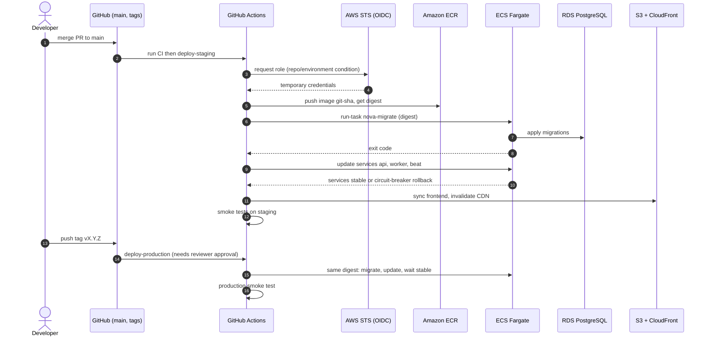
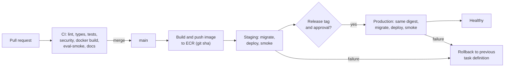

# NOVA AI — DevOps and CI/CD

Status: **design; no workflows, Dockerfiles, or AWS resources exist.** Action versions, runner images, and AWS behaviors must be verified when implementing. Related: [AWS_DEPLOYMENT](AWS_DEPLOYMENT.md), [TESTING_STRATEGY](TESTING_STRATEGY.md), [SECURITY](SECURITY.md), [DATA_FLOW](DATA_FLOW.md) Flow 6.

## 1. Git workflow
- **Trunk-based with short-lived feature branches.** `main` is always deployable and protected (no direct pushes, linear history via squash merge, required checks, ≥1 review once there is more than one contributor).
- Branch names: `feat/…`, `fix/…`, `chore/…`, `docs/…`. Conventional Commits (`feat:`, `fix:` …) to drive changelog/versioning.
- Pull requests: template with checklist (tests, docs, migration notes, security impact, ADR link if architectural).
- Pre-commit hooks (ruff, formatting, eslint, secret scan) as a convenience; CI is the authority.

## 2. Pull request checks (required)

| Job | Content |
|---|---|
| `backend` | `ruff check`, `ruff format --check`, type check (mypy/pyright on `ai/` and services), `pytest` with PostgreSQL+pgvector and Redis service containers, `makemigrations --check --dry-run`, import-linter module rules, coverage report |
| `frontend` | `npm ci`, eslint, `tsc --noEmit`, Vitest, `vite build` |
| `security` | `pip-audit`, `npm audit` (or OSV scanner), `bandit`, secret scan (gitleaks), dependency review action |
| `docker` | Build backend and frontend images (no push), container scan (e.g. Trivy), Dockerfile lint (hadolint) |
| `eval-smoke` | Deterministic retrieval-only mini evaluation vs baseline ([RAG_EVALUATION](RAG_EVALUATION.md) §9) |
| `docs` | Markdown link check, Mermaid syntax validation (`mmdc`/mermaid-cli) |

Caching: pip/npm caches, Docker layer cache (buildx cache). Path filters skip irrelevant jobs (but required checks must still report success).

## 3. Docker builds and image tagging
- **Backend image** (multi-stage): builder installs wheels; runtime is slim, non-root, no build tools. One image, three commands: ASGI server (API), `celery worker`, `celery beat`. Healthcheck via `/health/live`.
- **Frontend image:** used for local/compose and for the build stage; production serves **static files from S3/CloudFront**, so the deployable artifact is the `dist/` bundle.
- **Tags:** immutable `git-<sha>` for every build; `vX.Y.Z` on release; `latest` is **not** used for deployments. Deployments reference the **image digest**. ECR: immutable tags, scan on push, lifecycle policy to expire untagged/old images.
- **Base-image/dep updates:** scheduled rebuild + Dependabot/Renovate.
- **Build args vs runtime config:** the backend image contains no secrets; frontend bundle contains only public `VITE_*` values ([ENVIRONMENT_CONFIGURATION](ENVIRONMENT_CONFIGURATION.md)). Large ML model weights (reranker) either baked at build time with pinned revision or fetched at startup from a controlled source — **decision open**.

## 4. GitHub Actions → AWS via OIDC
- No long-lived AWS keys. Workflows request an OIDC token and assume an IAM role (`sts:AssumeRoleWithWebIdentity`).
- IAM trust policy conditions: `token.actions.githubusercontent.com:aud = sts.amazonaws.com` and `sub` restricted to `repo:<org>/<repo>:environment:staging` (and `…:environment:production`, or `ref:refs/tags/v*`).
- Separate roles per environment:
  - **`gha-staging-deploy`:** `ecr:*` push on the NOVA repositories, `ecs:RegisterTaskDefinition`, `ecs:UpdateService`, `ecs:RunTask`, `ecs:DescribeServices/Tasks`, `iam:PassRole` limited to the task/execution roles, S3 sync on the staging frontend bucket, `cloudfront:CreateInvalidation` on the staging distribution, CloudWatch Logs read for failure diagnostics.
  - **`gha-production-deploy`:** same shape, production resources; assumable only from the `production` GitHub environment (required reviewers).
- Pin third-party actions by commit SHA; set `permissions:` minimally per job (`id-token: write`, `contents: read`).

## 5. Environments and promotion

| Environment | Trigger | Approval | Data |
|---|---|---|---|
| Local | developer | — | docker-compose, fake or real dev provider keys |
| CI | PR | automated | ephemeral |
| **Staging** | merge to `main` | automatic | synthetic/test data, real provider keys with low spend caps |
| **Production** | Git tag `vX.Y.Z` (or manual dispatch) | **GitHub environment required reviewers** | real users |

**Build once, deploy many:** the image built for `main` (digest) is promoted to production unchanged; production never rebuilds.

## 6. Proposed workflow design

### 6.1 `ci.yml` (pull_request, push to main)
Jobs `backend`, `frontend`, `security`, `docker` in parallel → `eval-smoke` after `backend`. Required status checks on `main`.

### 6.2 `deploy-staging.yml` (push to main, after CI success)
```yaml
# sketch only — not a working file
name: deploy-staging
on: { workflow_run: { workflows: [ci], types: [completed], branches: [main] } }
permissions: { id-token: write, contents: read }
jobs:
  build-push:
    if: ${{ github.event.workflow_run.conclusion == 'success' }}
    steps:
      - checkout
      - configure-aws-credentials (role: gha-staging-deploy, OIDC)
      - login ECR; docker buildx build --push -t $REPO:git-$SHA
      - output image digest
  migrate:
    needs: build-push
    steps:
      - ecs run-task (task def: nova-migrate, image digest) --wait; fail on non-zero exit
  deploy:
    needs: migrate
    steps:
      - render task definitions (api, worker, beat) with new image digest
      - ecs update-service; wait services-stable
      - frontend: npm ci && npm run build; aws s3 sync dist/ → staging bucket; cloudfront invalidate
  smoke:
    needs: deploy
    steps: [ curl /health/ready, run Playwright smoke against staging ]
```

### 6.3 `deploy-production.yml` (tag `v*.*.*` or manual)
`environment: production` (approval gate) → verify the tag's commit was deployed to staging and passed smoke → migrate → deploy **same digest** → wait stable → health + smoke → notify. Concurrency group prevents overlapping deployments.

### 6.4 `eval-full.yml` (schedule, manual, release candidate)
Runs the full benchmark with provider secrets from a protected environment; uploads report; fails on regression gates ([RAG_EVALUATION](RAG_EVALUATION.md) §8).

### 6.5 `security-scheduled.yml`
Weekly dependency/image scans, ZAP baseline on staging.

## 7. Database migrations in deployment
- A dedicated **one-off ECS task** (`nova-migrate`, same image, command `manage.py migrate --noinput`) runs **before** services update.
- Migrations must be **backward compatible with the currently running version** (expand/contract), because old tasks serve traffic during rollout.
- Failure of the migrate task aborts the deployment (services untouched).
- Rollback does **not** reverse migrations automatically; destructive changes are done in a later release after the code stopped using them. Take (or verify) a recent RDS snapshot before risky production migrations.
- Extension creation (`vector`) is a documented manual/privileged step, not part of the app role's migrations.

## 8. Health checks, rollout, and rollback
- ALB target group health check → `/health/ready` (or `/health/live` if readiness should not remove tasks during transient Redis blips — decision to document); ECS container health check → `/health/live`.
- ECS **deployment circuit breaker with rollback** enabled; minimum healthy percent 100 / max 200 for the API (rolling); workers drain gracefully (`SIGTERM` → finish or requeue task; `stopTimeout` set accordingly).
- Post-deploy automated smoke test (health, login with a test user, document list). Failure → pipeline triggers rollback job: `ecs update-service` to the previous task definition revision (digest recorded as a deployment output).
- Frontend rollback: previous bundle kept as versioned prefix/artifact; redeploy by re-syncing and invalidating CloudFront.
- Long streams during deploy: tasks receive `SIGTERM`; ALB deregistration delay and `stopTimeout` configured so in-flight streams can finish or end with a clean `error` event.

## 9. Release versioning
Semantic Versioning (`MAJOR.MINOR.PATCH`) for the application; API versioned separately (`/api/v1`). Releases created from tags with generated changelog (Conventional Commits). The API image tag, frontend bundle, and Git tag share the version; `GET /health/…` does not expose it publicly (version appears in a response header only for authenticated staff or in logs).

## 10. Deployment sequence



## 11. CI/CD pipeline overview



## 12. Observability of the pipeline
Deployment events annotated in CloudWatch (dashboard markers), notifications to chat/email on failure, DORA-style metrics (lead time, deployment frequency, change failure rate) tracked informally — no targets claimed.
