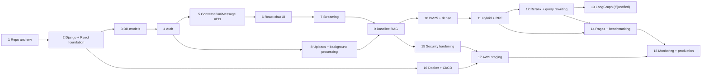

# NOVA AI — Implementation Roadmap

Status: **plan; no phase has started.** Phases are ordered by technical dependency. **Critical path** items are marked ⭐. Do not start a phase's advanced components before its prerequisites are done. Related: [PROJECT_OVERVIEW](PROJECT_OVERVIEW.md) (MVP definition), [TESTING_STRATEGY](TESTING_STRATEGY.md), [DECISIONS_AND_TRADEOFFS](DECISIONS_AND_TRADEOFFS.md) (open decisions).

## Dependency overview

Practical notes: CI (a subset of Phase 16) should start **early** (Phase 2). Phase 14's evaluation harness should begin as soon as Phase 10 produces retrievers, so later phases are measured.

## MVP cut line
**MVP = Phases 1–9 + a hardened subset of 15–16 + staging (17):** auth, chat with streaming, upload + ingestion, baseline grounded RAG with citations. Phases 10–14 are the "advanced release" (hybrid, RRF, rerank, evaluation); 18 is production readiness. (Alternatively Phase 10's hybrid retrieval can be pulled into MVP if the benchmark demonstrates its value early — decide after Phase 9.)

---

## Phase 1 — Repository and development environment
- **Objectives:** reproducible local setup.
- **Tasks:** create repo, structure ([README](../README.md)), `.gitignore`, `.env.example`, license, branch protection, pre-commit (ruff, eslint, gitleaks), `docker-compose.yml` (Postgres+pgvector, Redis, MinIO), Makefile/task runner, initial CI (lint only).
- **Files:** `infra/docker-compose.yml`, `.env.example`, `.pre-commit-config.yaml`, `.github/workflows/ci.yml`, `Makefile`.
- **Depends on:** none ⭐.
- **Deliverables:** `docker compose up` starts data services.
- **Acceptance:** fresh clone → services healthy in one command; `CREATE EXTENSION vector` works in dev DB.
- **Testing:** CI runs lint on empty projects.
- **Common mistakes:** committing `.env`; unpinned base images; skipping extension setup.
- **Definition of done:** README quick-start verified by someone other than the author (or a clean clone).

## Phase 2 — Django and React foundation
- **Objectives:** runnable skeletons with settings structure and health endpoints.
- **Tasks:** Django project `config/` (split settings, env validation), DRF, ASGI server, logging with request ids, `GET /health/*`; Vite+React+TS+Tailwind+shadcn/ui+React Router+TanStack Query, API client with CSRF handling, layout shell; pytest + Vitest scaffolds; Dockerfiles (dev).
- **Files:** `backend/config/settings/*`, `backend/apps/common/*`, `frontend/src/{lib,routes,pages}/*`.
- **Depends on:** 1 ⭐.
- **Deliverables:** frontend shows backend health status via proxy.
- **Acceptance:** `pytest` and `vitest` pass in CI; typed API client in place.
- **Common mistakes:** no custom user model decision yet (do it in Phase 3 **before first migration**); mixing prod/dev settings.
- **DoD:** CI green (lint, types, tests, build).

## Phase 3 — PostgreSQL and database models
- **Objectives:** schema for MVP tables.
- **Tasks:** custom `User` first migration; models Conversation, Message, Document, DocumentChunk (with `vector`, `tsvector`), MessageSource, Feedback (optional now); constraints and indexes ([DATABASE_DESIGN](DATABASE_DESIGN.md)); admin registration; factories; extension step documented.
- **Files:** `apps/*/models.py`, migrations, `tests/factories.py`.
- **Depends on:** 2; **decision: embedding dimension** ⭐.
- **Deliverables:** migrations apply on fresh DB; constraint tests.
- **Acceptance:** all constraints enforced by tests; `makemigrations --check` clean.
- **Common mistakes:** default Django user model; wrong vector dimension; forgetting `owner_id` denormalization invariant.
- **DoD:** DB integration tests pass on pgvector service container.

## Phase 4 — Authentication and authorization
- **Objectives:** secure sessions, owner-scoped access.
- **Tasks:** CSRF endpoint, register/login/logout, profile, Argon2, throttling, owner-scoped base viewset/mixin, 404 policy, React auth pages and route guards, error display.
- **Files:** `apps/accounts/*`, `apps/common/permissions.py`, `frontend/src/features/auth/*`.
- **Depends on:** 3 ⭐.
- **Deliverables:** working login flow in browser.
- **Acceptance:** isolation test matrix (user A/B) passes; cookie flags verified; timing/generic error behavior tested.
- **Common mistakes:** exempting endpoints from CSRF "for convenience"; leaking 403 vs 404; storing tokens in localStorage.
- **DoD:** security checklist items for auth satisfied ([SECURITY](SECURITY.md) §2–5).

## Phase 5 — Conversation and message APIs
- **Objectives:** CRUD and history with pagination.
- **Tasks:** conversations CRUD, messages list (cursor pagination), sequence allocation, error envelope, OpenAPI schema generation, API tests.
- **Files:** `apps/conversations/{models,serializers,views,services}.py`.
- **Depends on:** 4 ⭐.
- **Deliverables:** documented, tested endpoints (without chat generation).
- **Acceptance:** contract matches [API_SPECIFICATION](API_SPECIFICATION.md); concurrency test for sequences.
- **Common mistakes:** offset pagination; returning internal fields.
- **DoD:** API tests + OpenAPI diff reviewed.

## Phase 6 — React chat interface
- **Objectives:** usable chat UI with a stubbed assistant.
- **Tasks:** sidebar (conversations), message list, Markdown + code highlighting (sanitized), composer, optimistic updates, empty/loading/error states, a11y basics. Temporary non-RAG echo or fake responder behind the real endpoint contract.
- **Files:** `frontend/src/features/chat/*`, `components/*`.
- **Depends on:** 5.
- **Deliverables:** conversation management and rendering.
- **Acceptance:** component + MSW integration tests; XSS sanitization test.
- **Common mistakes:** raw HTML rendering; no abort handling.
- **DoD:** E2E test (fake provider) for create → send → render.

## Phase 7 — Streaming responses
- **Objectives:** SSE end-to-end with a real or fake LLM (no retrieval yet).
- **Tasks:** `LLMProvider` interface + adapter + fake; async SSE view; heartbeat; cancel handling; partial persistence; frontend stream parser, abort button, error states; provider timeout/retry.
- **Files:** `ai/generation/*`, `apps/conversations/streaming.py`, `frontend/src/services/sse.ts`.
- **Depends on:** 6 ⭐; **decision: LLM provider**.
- **Deliverables:** tokens stream; disconnect leaves a `cancelled` message.
- **Acceptance:** streaming and failure tests ([TESTING_STRATEGY](TESTING_STRATEGY.md) §13); verified through a reverse proxy locally (buffering check).
- **Common mistakes:** sync generators blocking threads; compression buffering; holding DB transactions during streaming; not closing provider streams.
- **DoD:** documented and tested lifecycle matching [DATA_FLOW](DATA_FLOW.md) Flow 4.

## Phase 8 — Document uploads and background processing
- **Objectives:** reliable ingestion up to "chunks stored with embeddings".
- **Tasks:** upload endpoint, validators, S3 storage adapter (MinIO dev), duplicate handling, status/polling, Celery setup, `ingest_document` task (extract → normalize → chunk → embed → atomic swap), retries, reconciler, reindex, delete + purge; `EmbeddingProvider` + fake; React upload UI + document list + status.
- **Files:** `apps/documents/*`, `ai/ingestion/*`, `ai/embeddings/*`, `frontend/src/features/documents/*`.
- **Depends on:** 4 (auth) ⭐; **decisions: embedding model, parsing libraries**.
- **Deliverables:** upload → `ready` with chunks and vectors.
- **Acceptance:** ingestion test suite ([TESTING_STRATEGY](TESTING_STRATEGY.md) §8) incl. crash/retry/idempotency; deletion cuts retrieval immediately.
- **Common mistakes:** enqueuing before commit; non-idempotent tasks; trusting client MIME type; parsing in the API process; logging document text.
- **DoD:** all failure paths yield user-safe `error_code`s.

## Phase 9 — Baseline RAG ⭐
- **Objectives:** end-to-end grounded answers with citations using the **simplest** retrieval (dense only).
- **Tasks:** dense retriever with permission filter, evidence selection + budgets, prompt builder (versioned), citation parser/validator, `MessageSource` persistence, abstention gate (simple), UI citations/source panel, feedback endpoint + UI.
- **Files:** `ai/retrieval/dense.py`, `ai/generation/{prompt,citations}.py`, `ai/workflows/answer.py`, `frontend/src/features/chat/Citations*`.
- **Depends on:** 7 and 8 ⭐.
- **Deliverables:** answer + clickable sources; abstention message on unanswerable questions.
- **Acceptance:** retrieval isolation tests; citation correctness tests; manual demo on sample corpus; first small eval dataset drafted.
- **Common mistakes:** retrieving before filtering by owner; sending all chunks; uncited claims; over-trusting the model's markers.
- **DoD:** every chat turn is traceable (ids, timings) without logging content.

## Phase 10 — BM25 and dense vector retrieval
- **Objectives:** both retrievers as independent, tested components with a common interface.
- **Tasks:** `LexicalRetriever` (PG FTS) and optionally in-memory BM25; harden dense retriever; indexes + `EXPLAIN` checks; retriever comparison harness (retrieval-only) on the eval corpus (start Phase 14 groundwork).
- **Files:** `ai/retrieval/{lexical,bm25,dense,interfaces}.py`.
- **Depends on:** 9.
- **Deliverables:** C1 and C2 runnable.
- **Acceptance:** retrieval unit/integration tests; Recall@k/MRR reported for C1, C2.
- **Common mistakes:** treating FTS as BM25 in docs/UI; unparameterized SQL; ignoring language config.
- **DoD:** lexical backend decision recorded (ADR-003).

## Phase 11 — Hybrid search and RRF
- **Objectives:** C3.
- **Tasks:** parallel retrieval, RRF function (pure, property-tested), degraded-mode fallbacks, config flags, caching with retrieval epoch (optional).
- **Files:** `ai/retrieval/{fusion,hybrid}.py`.
- **Depends on:** 10 ⭐.
- **Acceptance:** RRF tests with hand-computed values; hybrid beats/does not beat C1/C2 — **recorded as measured**, not assumed.
- **Common mistakes:** fusing scores rather than ranks; non-deterministic tie-breaking.
- **DoD:** C1–C3 benchmark results documented.

## Phase 12 — Reranking and query rewriting
- **Objectives:** C4 and follow-up handling.
- **Tasks:** `Reranker` interface + chosen implementation + timeout/fallback; sizing the container; query rewrite step (LLM) with fallback; sufficiency threshold calibration.
- **Files:** `ai/retrieval/rerank.py`, `ai/workflows/rewrite.py`.
- **Depends on:** 11; **decision: reranker model/hosting**.
- **Acceptance:** C4 vs C3 measured for quality **and** latency; rewrite improves follow-up recall (measured) or is dropped.
- **Common mistakes:** reranking too many candidates; no timeout; rewriting that drops key terms.
- **DoD:** decision to keep/drop reranking recorded with data.

## Phase 13 — LangGraph integration (only if justified)
- **Objectives:** conditional routing/retry only if the gate in [AI_WORKFLOW_DESIGN](AI_WORKFLOW_DESIGN.md) §8 passes.
- **Tasks:** implement graph equivalent of the baseline; add route/broaden/abstain nodes; compare with baseline benchmark; integrate streaming.
- **Depends on:** 12, 14 harness ⭐(for the gate).
- **Acceptance:** equal-or-better benchmark results; node-level tests; bounded loops.
- **Common mistakes:** adopting for novelty; unbounded retries; letting framework state hold secrets/persistence.
- **DoD:** adopted or explicitly rejected via ADR.

## Phase 14 — Ragas evaluation and benchmarking
- **Objectives:** repeatable measurement ([RAG_EVALUATION](RAG_EVALUATION.md)).
- **Tasks:** corpus + dataset curation, span-overlap labeling, runner, deterministic metrics, Ragas adapter, statistics, reports, baseline storage, CI jobs (smoke + scheduled), `EvaluationRun` model.
- **Files:** `evaluation/*`, `ai/evaluation/*`, `apps/evaluations/*`.
- **Depends on:** 10 (start), 11–12 (full) .
- **Acceptance:** run reproduces within tolerance; C1–C4 report with confidence intervals; thresholds calibrated.
- **Common mistakes:** tuning on the test split; trusting LLM judges alone; tiny datasets; unversioned configs.
- **DoD:** benchmark procedure executed end-to-end and archived.

## Phase 15 — Security hardening
- **Tasks:** CSP/headers, throttles tuned, AuditEvent, dependency/secret/container scanning, upload hardening (limits, zip-bomb guards, optional AV), prompt-injection test suite, log-redaction tests, authorization re-check alarms, account deletion, DB roles.
- **Depends on:** 9 (earlier items continuous) ⭐ before staging.
- **Acceptance:** [SECURITY](SECURITY.md) checklist reviewed; security tests green; ZAP baseline clean or triaged.
- **Common mistakes:** treating it as a one-time phase; disabling findings.
- **DoD:** documented residual risks.

## Phase 16 — Docker and CI/CD
- **Tasks:** production Dockerfiles (multi-stage, non-root), compose parity, full CI ([DEVOPS_AND_CICD](DEVOPS_AND_CICD.md)), ECR push workflow, OIDC, deploy workflows (staging first), migration task definition.
- **Depends on:** 2 (start), 15 (final).
- **Acceptance:** image builds reproducibly; CI blocks bad PRs; images scanned.
- **Common mistakes:** `latest` tags; baking secrets; rebuilding per environment.
- **DoD:** deploy pipeline dry-run succeeds against a scratch environment.

## Phase 17 — AWS staging deployment
- **Tasks:** IaC for VPC, RDS (pgvector verified), ElastiCache, S3, ECR, ECS, ALB, CloudFront, Secrets, IAM, CloudWatch; staged plan ([AWS_DEPLOYMENT](AWS_DEPLOYMENT.md) §11); verify streaming through CloudFront/ALB; backup restore drill; load test baseline.
- **Depends on:** 15, 16; **decisions: IaC tool, account strategy** ⭐.
- **Acceptance:** E2E smoke on staging; rollback rehearsed; alarms fire in test.
- **Common mistakes:** public DB; wide IAM; no NAT/endpoints plan; skipping restore drill.
- **DoD:** runbook for deploy/rollback written and exercised.

## Phase 18 — Monitoring, optimization, and production release
- **Tasks:** dashboards/alerts ([OBSERVABILITY_AND_RELIABILITY](OBSERVABILITY_AND_RELIABILITY.md)), cost controls, performance tuning from measurements (indexes, concurrency, caching), production environment, release approval, post-launch review.
- **Depends on:** 14, 17.
- **Acceptance:** alerts routed and tested; budget alarms; production smoke; documented SLO baselines.
- **Common mistakes:** launching without alert ownership; tuning without profiling.
- **DoD:** v1.0.0 tagged and deployed via the approved pipeline; roadmap updated with measured reality.

---

## Critical path summary ⭐
1 → 2 → 3 → 4 → 5 → 6 → 7 → 8 (parallel with 5–7 after 4) → 9 → 10 → 11 → 14 (harness) → 15 → 16 → 17 → 18. Reranking (12) and LangGraph (13) are off the critical path for the MVP and gated by evidence.
