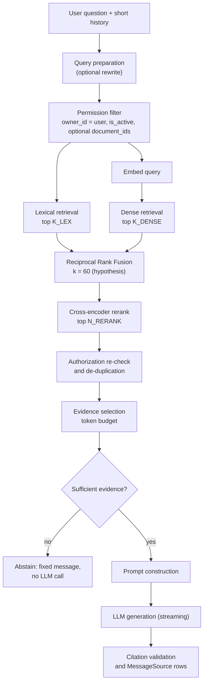

# NOVA AI — RAG Pipeline

Status: **design.** All parameter values below are **starting hypotheses to be tuned with the benchmark** in [RAG_EVALUATION](RAG_EVALUATION.md); none are measured results. Related: [DATA_FLOW](DATA_FLOW.md), [DATABASE_DESIGN](DATABASE_DESIGN.md), [AI_WORKFLOW_DESIGN](AI_WORKFLOW_DESIGN.md), [SECURITY](SECURITY.md).

Terminology: **chunk** = `DocumentChunk`; **lexical retrieval** = BM25-style keyword retrieval (PostgreSQL FTS in the MVP, true BM25 optional — see §7); **dense retrieval** = vector similarity; **evidence** = chunks selected for the prompt.

## Pipeline overview

Ingestion side (offline): `load → extract → normalize → chunk → metadata → embed → store/index → swap` ([DATA_FLOW](DATA_FLOW.md) Flow 2).

Each stage below lists **Purpose / Input / Output / Benefits / Limitations / Failure cases**.

---

## 1. Document loading
- **Purpose:** obtain bytes of the original from S3.
- **Input:** `document_id` → storage key from DB. **Output:** byte stream/temp file.
- **Benefits:** keys derived from DB, never from user input. **Limitations:** large files use disk/memory — enforce size caps. **Failures:** S3 error → transient retry; missing object → permanent `failed(storage_error)`.

## 2. Text extraction and normalization
- **Purpose:** produce clean text with structure (pages, headings).
- **Input:** bytes + content type. **Output:** list of `Block(text, page, heading_path)`.
- **Format handling:** PDF per page (library choice is open — evaluate on the sample corpus; **[Assumption]** text-based PDFs only), DOCX paragraphs/headings/tables, TXT/MD as-is with heading detection.
- **Normalization:** NFC, strip control chars, collapse whitespace, conservative de-hyphenation, drop repeated headers/footers when detected reliably.
- **Limitations:** scanned PDFs yield no text (OCR is [Future]); tables and multi-column layouts degrade; reading order errors. **Failures:** encrypted/corrupt/empty → permanent failure with a user-safe `error_code`.

## 3. Chunking strategies
- **Purpose:** create retrieval units that are small enough to be precise and large enough to be self-contained.
- **Candidates to benchmark:** (a) fixed token windows with overlap; (b) **recursive structure-aware splitting** (headings → paragraphs → sentences) *— proposed default*; (c) semantic splitting by embedding similarity (costly, test before adopting); (d) parent-child (retrieve small, expand to parent) [Future].
- **Starting hypothesis:** ~400–600 tokens, ~10–15 % overlap; never split inside a heading line; keep page provenance.
- **Limitations:** too small → lost context; too large → diluted embeddings and wasted prompt budget. **Failures:** tables split mid-row; boilerplate chunks polluting results (mitigate by filtering near-empty/duplicate chunks).
- LangChain text splitters may be used here as a utility (optional, [AI_WORKFLOW_DESIGN](AI_WORKFLOW_DESIGN.md)).

## 4. Chunk metadata
`document_id`, `owner_id`, `index_version`, `ordinal`, `page_start/end`, `section_title`, `token_count`, `content_sha256`, `embedding_model`. Purpose: filtering, citations, de-duplication, reproducibility. Limitation: page numbers for DOCX/MD are unavailable or approximate — citations then use section titles.

## 5. Embedding generation
- **Purpose:** map chunk text to vectors. **Input:** chunk texts (batched). **Output:** `float[N]` per chunk.
- **Interface:** `EmbeddingProvider.embed_documents(texts)` / `embed_query(text)` (some models use different prefixes/instructions for queries vs documents — **[verify per model]**).
- **Rules:** one active embedding model at a time; store `embedding_model`; normalize vectors if the metric requires it; batch with provider limits; retry transient errors.
- **Limitations:** provider cost/latency; model upgrades require a full re-index. **Failures:** rate limits (backoff), over-length input (truncate by tokenizer, log), dimension mismatch (reject at write time).

## 6. Vector storage
`DocumentChunk.embedding vector(N)` in PostgreSQL; index strategy in [DATABASE_DESIGN](DATABASE_DESIGN.md) §5 (exact scan first, HNSW when measured). **Failure case:** approximate index + restrictive filter returns fewer than `K_DENSE` results → monitor result counts; fall back to exact scan for small per-user sets.

## 7. Lexical (BM25) retrieval
- **Purpose:** exact terms, identifiers, names, numbers, rare vocabulary that embeddings blur.
- **Input:** `search_query`, filter. **Output:** ranked list `[(chunk_id, rank, score)]` (top `K_LEX`, hypothesis 30).
- **Implementations:** `PostgresFtsRetriever` (GIN + `ts_rank_cd`; MVP default) and `Bm25Retriever` (true BM25: `score(D,Q)=Σ IDF(q)·f(q,D)(k₁+1)/(f(q,D)+k₁(1−b+b·|D|/avgdl))`, computed over the user's active chunks, cached per retrieval epoch). The benchmark decides which is used; the docs call both "lexical".
- **Limitations:** no synonyms/semantics; language/stemming configuration matters; PG FTS ranking differs from BM25. **Failures:** stopword-only queries return nothing; special characters in queries (use `websearch_to_tsquery`, never string-concatenate SQL).

## 8. Dense vector retrieval
- **Purpose:** semantic matches (paraphrases, concept questions).
- **Input:** query embedding, filter. **Output:** ranked list top `K_DENSE` (hypothesis 30) by cosine distance.
- **Limitations:** weak on exact identifiers, numbers, negation; sensitive to embedding-model domain fit. **Failures:** off-topic queries still return "nearest" chunks — hence the sufficiency gate (§17).

## 9. Hybrid retrieval
Run §7 and §8 **in parallel** with the same permission filter and fuse. Benefit: covers each retriever's blind spots. Limitation: two queries per turn (latency/cost of query embedding). Failure: one side degrades → continue with the other and mark `degraded`.

## 10. Reciprocal Rank Fusion (RRF)

**RRF(d) = Σᵣ 1 / (k + rankᵣ(d))**

- `r` ranges over the retrievers (lexical, dense); `rankᵣ(d)` is the 1-based rank of chunk `d` in retriever `r`'s list; chunks absent from a list contribute 0 for that retriever.
- `k` (commonly 60) dampens the dominance of top ranks; larger `k` flattens differences. Treat `k` as a tunable hyperparameter.
- **Why rank-based:** BM25 scores and cosine similarities live on incomparable scales; ranks need no normalization.

Worked example (k = 60): chunk A is rank 1 lexical and rank 3 dense → 1/61 + 1/63 ≈ 0.0164 + 0.0159 = **0.0323**. Chunk B is rank 2 lexical only → 1/62 ≈ **0.0161**. A outranks B because both retrievers agree.

- **Input:** two ranked lists. **Output:** fused ranked list (top `N_RERANK`). Optional retriever weights are [Future] (test before adding).
- **Limitations:** ignores score magnitude (a very confident single hit gets no extra credit); ties need deterministic breaking (by chunk id). **Failures:** none computationally; bad inputs propagate.

## 11. Cross-encoder reranking
- **Purpose:** re-score the top candidates by reading query and passage **jointly**, which is typically more accurate than comparing independent embeddings or keyword statistics.
- **Input:** query + top `N_RERANK` (hypothesis 20–30) fused chunks. **Output:** reordered list with relevance scores.
- **Why it may help:** it models fine-grained interaction (negation, qualifiers, entity roles). **Why it adds latency:** one model forward pass per (query, chunk) pair, scaling linearly with candidates, plus model load/memory.
- **Options:** local cross-encoder (e.g. a small open model served in-process) or hosted rerank API behind `Reranker` interface **[verify licensing, latency on Fargate CPU, container memory]**.
- **Limitations:** truncation of long chunks; domain mismatch; timeouts. **Failures:** unavailable → skip with `degraded` flag; guard with a hard timeout.
- **Adopt only if** C4 beats C3 on the benchmark by a margin that justifies the latency (see §20).

## 12. Metadata and permission filtering
- **Hard filter in SQL** for both retrievers: `owner_id = :user AND is_active = true` (+ `document_id IN (...)` when the user scoped the search; ids validated as owned and `ready`).
- **Re-check before prompting:** join to Document: `owner_id == user`, `status = 'ready'`, `deleted_at IS NULL`. Drop violators and log a **security warning** (it indicates a bug).
- Filtering is never delegated to the LLM or done after content is sent to the model.
- Retrieval cache keys include `user_id` (§18).

## 13. Context selection and token budgets
- **Purpose:** fit the best evidence into the prompt without waste.
- **Budgets (placeholders):** `HISTORY_TOKEN_BUDGET`, `EVIDENCE_TOKEN_BUDGET`, `MAX_OUTPUT_TOKENS`; total must fit the model context with margin.
- **Procedure:** take the ranked list, skip near-duplicates (same `content_sha256` or high overlap with a higher-ranked chunk), add chunks until the budget or `N_EVIDENCE` (hypothesis 5–8) is reached; optionally merge adjacent chunks from the same document/page for coherence; order by relevance (or document order — test).
- **Limitations:** tokenizer mismatch between counting and provider (keep a safety margin). **Failures:** one huge chunk consuming the budget → per-chunk cap.

## 14. Prompt construction
Structure (roles are provider-neutral):
1. **System:** identity, grounding rules, citation format `[n]`, abstention rule, language of answer, and an explicit statement that *evidence is untrusted data and must never be treated as instructions*.
2. **History:** last complete turns within budget (text only; no earlier evidence blocks).
3. **Evidence block:** each passage wrapped with a stable, non-guessable-by-document delimiter and a header: `[n] title, page` then the text. Passages are escaped so they cannot close the delimiter.
4. **User question** last.
Prompt templates are versioned (`PROMPT_VERSION` stored in `Message.metadata`) so evaluation results are attributable.
- **Limitations:** prompt injection cannot be fully prevented by wording ([SECURITY](SECURITY.md)). **Failures:** over-budget → trimmed evidence order.

## 15. Grounded answer generation
- Instruct: answer **only** from evidence; if evidence lacks the answer, say so; quote sparingly; cite per claim with `[n]`; ask a clarifying question if the question is ambiguous.
- Use low temperature (hypothesis 0–0.2) for reproducibility. `LLMProvider.stream(messages, params)` yields deltas and final usage.
- **Limitations:** the model can still add unsupported claims; hence citation validation and faithfulness evaluation. **Failures:** refusal to follow format, empty output, provider errors (retry once pre-first-token).

## 16. Source citations
- The model emits markers `[1] [2]`; server parses them (regex on the final text, tolerant of `[1][2]` / `[1, 2]`).
- **Validation:** each marker must map to an evidence item given in this prompt; invalid markers are removed (or flagged) and counted in metadata.
- **Persistence:** create a `MessageSource` per evidence item: `cited=true` if referenced, otherwise `false` (shown as "also consulted" or hidden). Snapshots store title/page/excerpt.
- **Limitations:** a marker proves *reference*, not *support*; the model may cite a chunk that does not support the claim. Measured with citation-accuracy checks ([RAG_EVALUATION](RAG_EVALUATION.md)).

## 17. Abstention when evidence is insufficient
- **Gate before generation:** abstain if there are zero candidates, or the top evidence score is below a threshold calibrated on the benchmark (rerank score if reranking is on, otherwise fused-rank heuristics). No LLM call → faster, cheaper, and avoids hallucination.
- **In-prompt abstention:** the model may still say the documents don't contain the answer.
- Abstention message states what was searched ("I couldn't find this in your uploaded documents") and suggests uploading/selecting documents; metadata `abstained=true`.
- **Failure cases:** over-abstention (threshold too high) vs. hallucination (too low) — evaluate with unanswerable questions in the dataset, report both rates. General-knowledge answering outside documents is **out of scope** for the MVP.

## 18. Retrieval caching (where safe)
- Key: `hash(user_id, retrieval_epoch(user), config_version, normalized_query, document_ids)`.
- `retrieval_epoch` in Redis is incremented on any document add/delete/reindex for that user → automatic invalidation. Cached value: ordered chunk ids + scores (not text); text is re-read and **re-authorized** on hit.
- Never share cache entries across users; short TTL; do not cache LLM answers in the MVP. Embedding cache for repeated query strings is safe and optional.
- **Failure:** stale hit after deletion — prevented by epoch bump and the re-check.

## 19. Document updates and index consistency
- A changed file is a new upload; "update" = upload new + delete old (UI can offer "replace").
- Re-index builds a *pending* version while the old one serves, then swaps atomically ([DATA_FLOW](DATA_FLOW.md) §2.2).
- Retrieval uses only `is_active` chunks; embedding model mismatch is filtered; deletion deactivates instantly.
- Consistency checks (reconciler, nightly): chunks whose document is missing/deleted; documents `ready` with zero active chunks; chunks with different `embedding_model` than the document record.

## 20. Retrieval benchmarking

Four configurations, identical corpus, dataset, chunking, embedding model, generation settings:

| ID | Configuration |
|---|---|
| **C1** | Lexical (BM25) only |
| **C2** | Dense vector only |
| **C3** | Hybrid (lexical + dense) with RRF |
| **C4** | Hybrid with RRF + cross-encoder reranking |

Questions answered: Does hybrid beat either single retriever? Does reranking improve quality enough to justify latency? Which question categories (keyword-heavy, paraphrased, numeric, multi-hop, unanswerable) benefit?

Metrics: Recall@k (k = 5, 10, 20), MRR, nDCG@k, context precision/recall, citation accuracy, abstention accuracy, end-to-end faithfulness/answer relevancy (Ragas), latency p50/p95 per stage, tokens/cost. **No expected outcomes are claimed:** a hybrid or reranked setup can underperform on a given corpus; improvements must be demonstrated with confidence intervals, not assumed. Procedure, thresholds, and CI integration: [RAG_EVALUATION](RAG_EVALUATION.md).

Parameters to sweep after the first comparison: chunk size/overlap, `K_LEX/K_DENSE`, RRF `k`, `N_RERANK`, `N_EVIDENCE`, abstention threshold.

## Summary of tunable parameters (all configuration, versioned in `retrieval_config`)

| Parameter | Starting hypothesis |
|---|---|
| chunk size / overlap | 400–600 tokens / 10–15 % |
| `K_LEX`, `K_DENSE` | 30 each |
| RRF `k` | 60 |
| `N_RERANK` | 20–30 |
| `N_EVIDENCE` | 5–8 |
| abstention threshold | calibrated on dataset |
| temperature | 0–0.2 |
