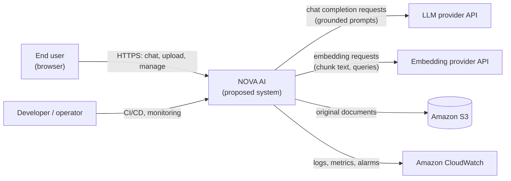
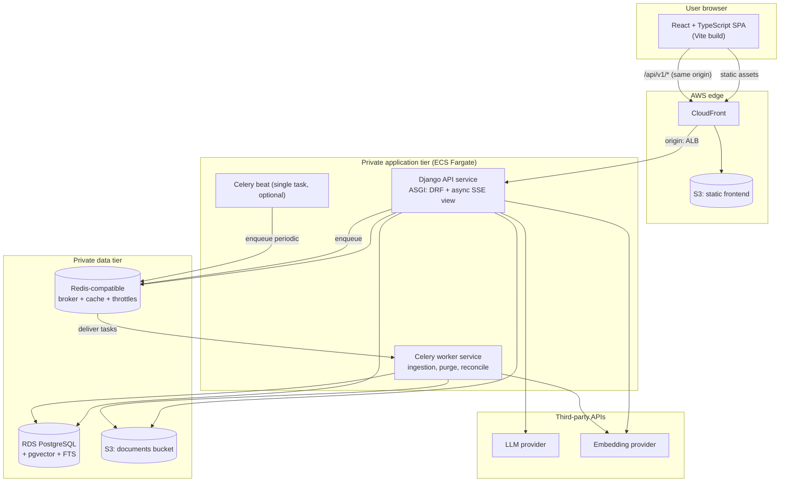
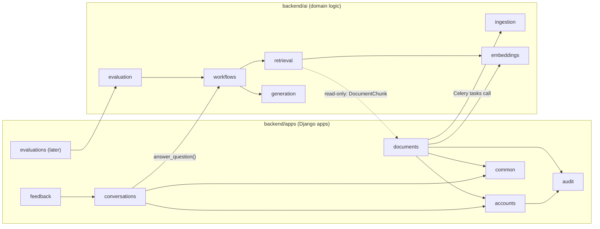
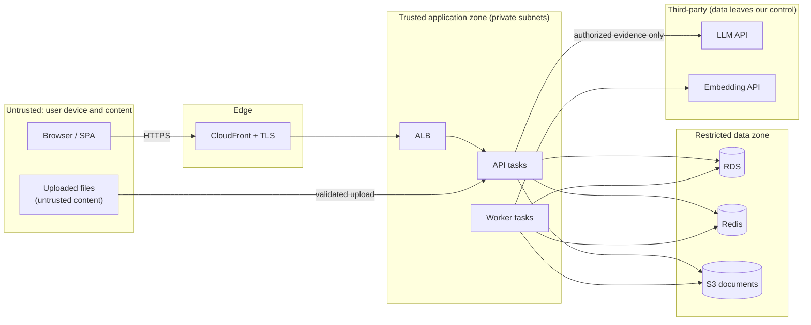
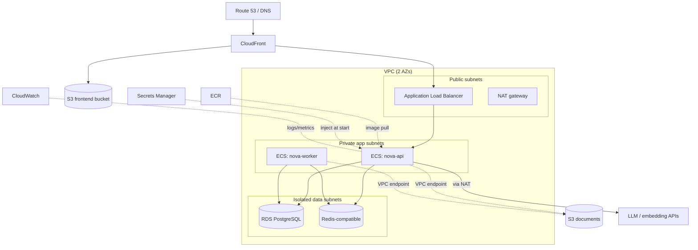

# NOVA AI — System Architecture

> **Status legend used in every document.**
> **[Requirement]** confirmed by the project brief · **[Recommendation]** proposed design choice ·
> **[Assumption]** must be verified before relying on it · **[Future]** explicitly not in the MVP.
> **Nothing described here is implemented yet.** This is a design blueprint; all components are *proposed*.

Related: [PROJECT_OVERVIEW](PROJECT_OVERVIEW.md) · [DATA_FLOW](DATA_FLOW.md) · [DATABASE_DESIGN](DATABASE_DESIGN.md) · [SECURITY](SECURITY.md) · [AWS_DEPLOYMENT](AWS_DEPLOYMENT.md) · [DECISIONS_AND_TRADEOFFS](DECISIONS_AND_TRADEOFFS.md)

---

## 1. Architectural principles

1. **Modular monolith first.** One Django codebase, one database, clear internal module boundaries. The only separately running processes are the API (ASGI) and Celery workers, both built from the *same* image/codebase.
2. **PostgreSQL is the system of record and the first retrieval engine.** pgvector (dense) and PostgreSQL full-text search (lexical) keep data, permissions, and vectors in one transactional store, so authorization filters and deletions are enforced in a single query.
3. **Authorization before retrieval, not after.** Every retrieval query is constrained by `owner_id`; a second check runs before prompt assembly (defense in depth). See [SECURITY](SECURITY.md).
4. **Predictable pipeline over agents.** Retrieval and generation are a fixed sequence of steps. LangGraph is introduced only for conditional routing/retry once evaluation shows a benefit ([AI_WORKFLOW_DESIGN](AI_WORKFLOW_DESIGN.md)).
5. **Everything provider-specific sits behind an interface** (LLM, embeddings, reranker, object storage).
6. **State lives in PostgreSQL, not in the queue.** Redis is a transport and cache; losing it must never lose a document's ingestion state.
7. **Measure, don't assume.** Retrieval improvements (hybrid, RRF, reranking) are adopted only if the benchmark in [RAG_EVALUATION](RAG_EVALUATION.md) supports them.
8. **Secure defaults, least privilege, no secrets in code.**

---

## 2. System context

External parties receive **only** (a) the user's question plus minimal conversation context and (b) authorized evidence passages. They never receive other users' data.

---

## 3. Container / component architecture

**Why same-origin routing?** CloudFront serves the SPA and forwards `/api/*` to the load balancer, so the browser sees a single origin. This enables first-party `HttpOnly` session cookies with `SameSite=Lax` and removes most CORS complexity ([ADR-006](DECISIONS_AND_TRADEOFFS.md)).

---

## 4. Component responsibilities

### 4.1 Frontend (React SPA) — *proposed*
- Routing (React Router), server-state caching (TanStack Query), UI (Tailwind, shadcn/ui).
- Chat UI: renders Markdown with syntax highlighting, consumes SSE via `fetch` + `ReadableStream`, handles abort/cancel, shows citations and document status.
- **Never** holds secrets or LLM keys. Does not make authorization decisions; it only reflects server responses.
- Renders model output as **untrusted**: raw HTML disabled, remote images blocked ([SECURITY](SECURITY.md) §Prompt injection).

### 4.2 Backend API (Django + DRF) — *proposed*
- Authentication (session + CSRF), authorization (object ownership), validation, throttling.
- CRUD for conversations, messages, documents, feedback.
- Orchestrates a chat turn: context loading, retrieval, generation, citation building, persistence — by calling the `ai` package through a narrow facade.
- Enqueues background jobs; never performs heavy ingestion in the request cycle.

### 4.3 AI/RAG subsystem (`backend/ai/`) — *proposed*
| Package | Responsibility |
|---|---|
| `ingestion` | Pure functions: extract text, normalize, chunk, attach metadata. No Django imports. |
| `embeddings` | `EmbeddingProvider` interface + provider adapters, batching, retry/backoff. |
| `retrieval` | Lexical retriever, dense retriever, RRF, reranker, permission-constrained queries, evidence selection. |
| `generation` | `LLMProvider` interface, prompt construction, citation parsing/validation, streaming. |
| `workflows` | Chat-turn orchestration. Baseline: plain Python. Optional later: LangGraph graph ([AI_WORKFLOW_DESIGN](AI_WORKFLOW_DESIGN.md)). |
| `evaluation` | Dataset loading, metric computation, Ragas adapter, benchmark runner. |

### 4.4 Background workers (Celery) — *proposed*
Run: document ingestion, re-indexing, document purge, stale-state reconciliation, retention cleanup. Same image as API, different entrypoint, separate ECS service so they scale independently.

### 4.5 Storage
- **PostgreSQL (RDS):** users, conversations, messages, document metadata, chunks (text + `tsvector` + `vector`), sources, feedback, audit, evaluation records.
- **S3:** original uploaded files only. Never in PostgreSQL.
- **Redis-compatible:** Celery broker, DRF throttle counters, optional retrieval cache, per-user retrieval epoch counters. No data that cannot be rebuilt.

### 4.6 External providers
LLM and embedding APIs are called **from the backend only**. Their credentials come from Secrets Manager. Provider choice is configuration (see [ENVIRONMENT_CONFIGURATION](ENVIRONMENT_CONFIGURATION.md)); the architecture does not assume a specific vendor.

---

## 5. Backend module relationships

**Dependency rules** (enforce with an import-linter check in CI — *recommendation*):
1. `ai.ingestion`, `ai.embeddings`, `ai.generation` must not import Django models.
2. `ai.retrieval` may import `apps.documents.models` **read-only** (it must query chunks); it must never write.
3. Django apps call into `ai` only through `ai.workflows` (chat) and `ai.ingestion`/`ai.embeddings` (ingestion tasks).
4. Persistence of ingestion results (chunk rows, status) is performed by `apps.documents`, not by `ai.ingestion`. This avoids a circular dependency.

**Changes from the brief's structure:** added `apps/audit` (AuditEvent) and `apps/evaluations` (EvaluationRun, Phase 14) so cross-cutting records do not bloat `common`. See [README](../README.md#repository-structure).

---

## 6. Synchronous vs. asynchronous processing

| Operation | Mode | Reason |
|---|---|---|
| Register / login / CRUD | Synchronous | Fast, DB-only |
| File upload (validate + store to S3 + metadata) | Synchronous | User needs immediate accept/reject |
| Text extraction, chunking, embedding, indexing | **Asynchronous (Celery)** | Slow, retryable, provider-dependent |
| Document delete (retrieval cut-off) | Synchronous | Chunks deactivated in-request so deleted content is instantly unretrievable |
| Document purge (S3 delete, chunk delete) | Asynchronous | Safe to retry |
| Chat turn (retrieve → generate → stream) | **Synchronous streaming in the API process** (SSE) | Latency-sensitive; user watches tokens; no queue hop |
| Evaluation runs | Out-of-band (CLI / CI job) | Costly; not user-facing |

*Recommendation:* chat generation is **not** a Celery task in the MVP. A queue hop adds latency and complicates streaming. Revisit if API worker capacity becomes the bottleneck (see [ADR-007](DECISIONS_AND_TRADEOFFS.md)).

---

## 7. Authentication and authorization boundaries

- **Authentication:** Django session cookie (`HttpOnly`, `Secure`, `SameSite=Lax`) + CSRF token header. Established at the API; the SPA never sees credentials after login.
- **Authorization:** object-level ownership. Every queryset is scoped by `request.user`. Non-owned resources return **404** (not 403) to avoid revealing existence.
- **Retrieval authorization:** `owner_id = :user_id AND is_active` is part of the SQL of both retrievers; evidence is re-verified before reaching the prompt.
- **Workers** act on behalf of a document's owner; they take IDs, never user-supplied paths, and derive S3 keys from DB rows.
- **Multi-tenancy:** [Future]. The MVP is single-owner (each user sees only their own data). Chunks carry `owner_id` so an `organization_id` scope can be added without redesigning retrieval.

---

## 8. Trust and security boundaries

Boundary rules:
- Everything crossing **Z1 → Z3** is validated (schema, size, type, ownership).
- **Retrieved passages are untrusted data**, even though they live in Z4 — they are user-supplied text. They are inserted into prompts as quoted evidence, never as instructions.
- **Z3 → Z5** transfers are the privacy-sensitive hop: only authorized evidence and necessary history are sent. Provider data-retention terms must be reviewed before real user data is used **[Assumption to verify]**.
- Data tier accepts connections only from the application security groups.

---

## 9. Deployment architecture (summary)

Full topology, security groups, and IAM: [AWS_DEPLOYMENT](AWS_DEPLOYMENT.md).

---

## 10. Failure handling (architectural level)

| Failure | Behavior |
|---|---|
| LLM provider timeout / 5xx | Retry once (idempotent, pre-first-token only); otherwise stream `error` event, persist assistant message as `failed`, UI offers retry. |
| Embedding provider failure at query time | Fall back to lexical-only retrieval for this turn; record `degraded=true` in message metadata. |
| Embedding provider failure during ingestion | Celery retry with exponential backoff + jitter; after max attempts → `failed` with `error_code`. |
| Reranker unavailable / timeout | Skip reranking, use RRF order; flag `degraded`. |
| Redis unavailable | Uploads still stored; enqueue fails → document stays `uploaded`; reconciler re-enqueues. Throttling fails *closed* for auth endpoints, *open* for read endpoints (documented choice). |
| Worker crash mid-task | `acks_late` redelivery + idempotent task; reconciler re-queues stale `processing` documents. |
| DB failover | Connection retry; in-flight streams end with `error`; clients retry. |
| S3 failure on upload | Reject with 503; no `queued` state is reached. |
| Client disconnects mid-stream | Generation cancelled; partial text persisted with `status=cancelled`. |

---

## 11. Scalability considerations

- **API:** stateless; scale horizontally on CPU/request count. Streaming connections are long-lived, so size by concurrent streams, not RPS.
- **Workers:** scale on queue depth; embedding-provider rate limits are the first ceiling, so use a bounded concurrency setting.
- **Database:** first bottleneck is likely vector search + FTS on one instance. Mitigations in order: right-sized indexes, `EXPLAIN ANALYZE`, read replica for retrieval, then reconsider a dedicated vector store ([ADR-002](DECISIONS_AND_TRADEOFFS.md)). No numeric capacity claims are made; capacity must be measured with the load tests in [TESTING_STRATEGY](TESTING_STRATEGY.md).
- **Reranker:** CPU-bound if run locally; cap candidates and timeouts, or move to a hosted rerank API behind the same interface.

---

## 12. Major trade-offs

| Decision | Gain | Cost |
|---|---|---|
| Monolith + workers | Simple deploy, transactional consistency | Module boundaries rely on discipline |
| pgvector + PG FTS | One store, filters are trivial, easy deletes | Lower ceiling than dedicated engines; FTS ranking is not true BM25 (see [RAG_PIPELINE](RAG_PIPELINE.md)) |
| Session cookies | Simple, revocable, CSRF-defended | Needs same-site deployment; not ideal for third-party/mobile clients |
| Streaming in API process | Low latency, simple | Ties up ASGI capacity; needs heartbeat and timeout tuning |
| Upload via Django | Central validation | API memory/bandwidth; presigned direct-to-S3 is a [Future] option |
| Local cross-encoder | No extra vendor | CPU latency, container memory |

---

## 13. Implemented vs. proposed

| Component | Status |
|---|---|
| All components in this document | **Proposed — not implemented** |
